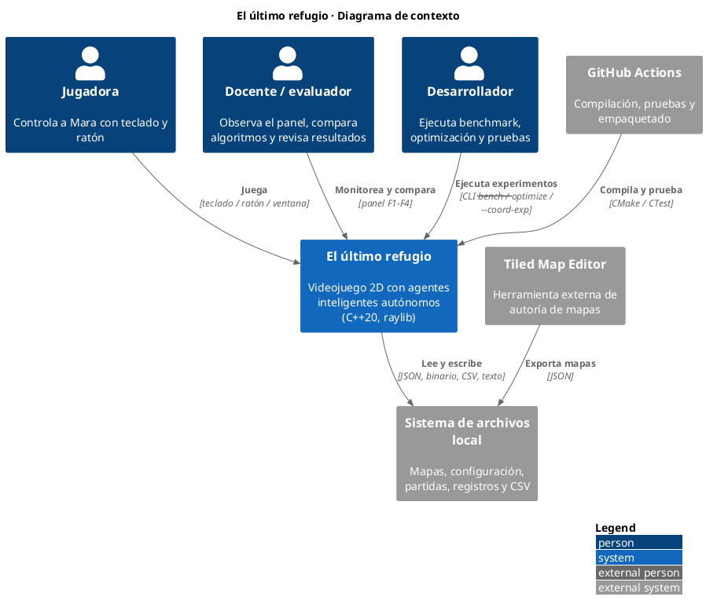
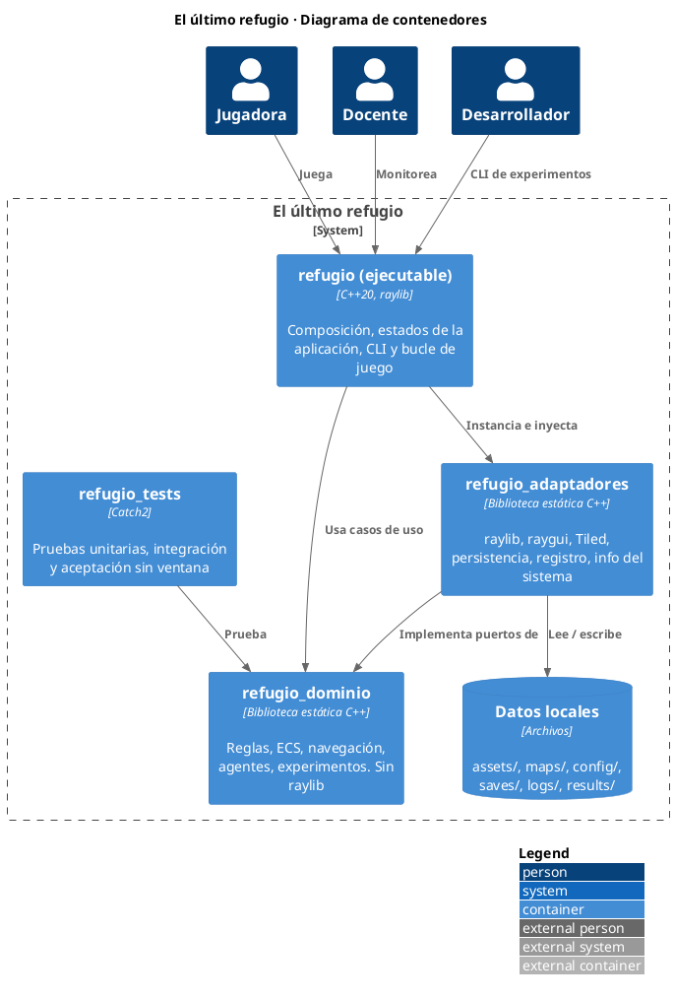
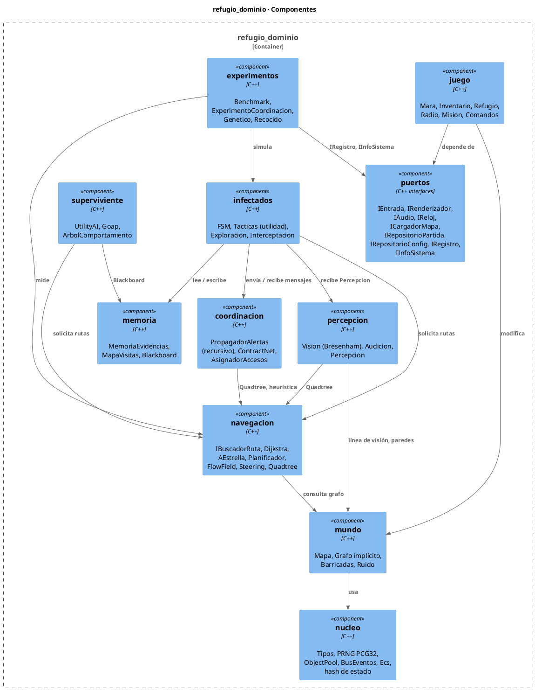
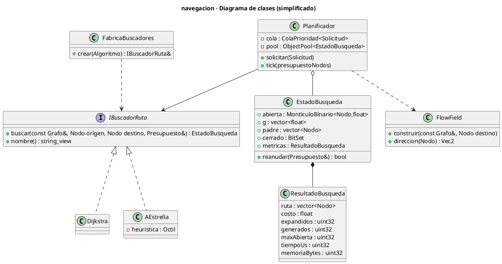
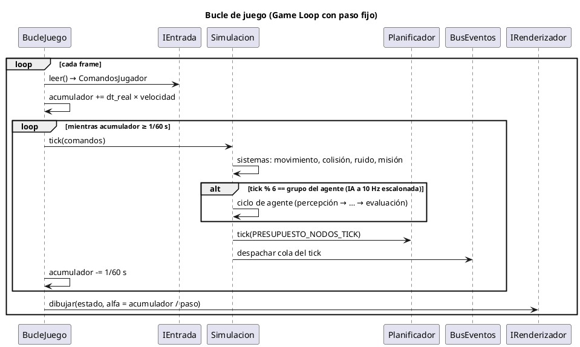
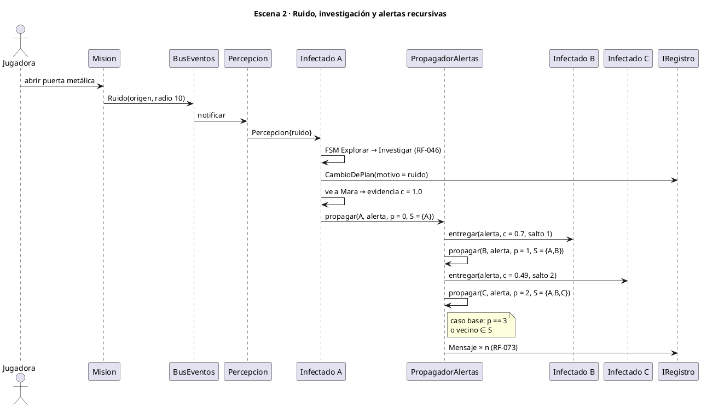
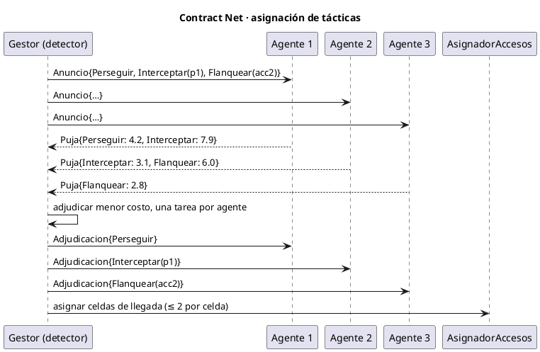
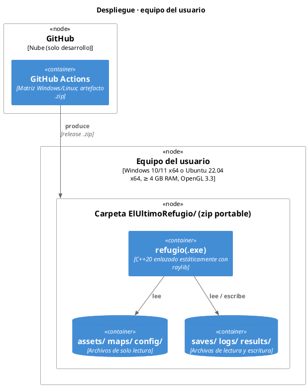
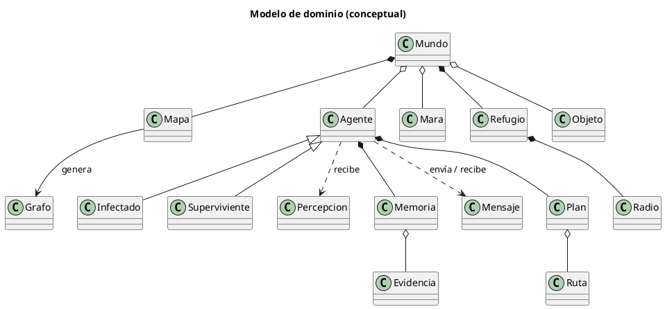

# 07 · Documentación de arquitectura (arc42 + C4)

> Plantilla **arc42** v8 con diagramas del modelo **C4** en PlantUML (biblioteca estándar `C4-PlantUML`).
> Las decisiones se registran como **ADR** en [adr/](adr/README.md).

| Campo | Valor |
|---|---|
| Versión | 0.1.0 |
| Fecha | 2026-11-21 |
| Estado | Borrador |
| Renderizado de diagramas | `plantuml -tsvg docs/*.md` o la extensión PlantUML de VS Code; Doxygen incluye los `.puml` de `docs/diagramas/` |

---

## 1. Introducción y metas

### 1.1 Resumen de requisitos

El último refugio es un juego 2D de vista cenital donde Mara reúne medicamentos, combustible y una batería
para activar una radio y escapar, mientras una horda de infectados autónomos la busca usando solo lo que
percibe, recuerda y se comunica. Los requisitos clave son:

| Requisito clave | Referencia |
|---|---|
| Ciclo de agente completo y observable, sin omnisciencia | RF-040, RF-041, RF-070 |
| Dijkstra y A\* sobre el mismo grafo, comparables en vivo y en benchmark | RF-020 a RF-024, RF-074, RF-080 |
| Recursión acotada: propagación de alertas con visitados | RF-047, RNF-027 |
| Coordinación: Contract Net y distribución de aproximaciones | RF-049, RF-051 |
| Replanificación ante señuelos y barricadas | RF-025, RF-050, RF-052 |
| Experimentos reproducibles | RF-080 a RF-086, RNF-020 |
| Bajo consumo en equipos modestos | RNF-001 a RNF-008 |

### 1.2 Metas de calidad (top 5)

| Prioridad | Meta | Escenario | RNF |
|---|---|---|---|
| 1 | **Eficiencia**: fluido en un portátil de 4 GB con 100 agentes | QS-01, QS-05 | RNF-001 a RNF-006 |
| 2 | **Corrección y reproducibilidad** de algoritmos y experimentos | QS-02, QS-03 | RNF-019, RNF-020 |
| 3 | **Observabilidad** de las decisiones de los agentes | — | RF-070 a RF-073, RNF-018 |
| 4 | **Mantenibilidad y capacidad de prueba** del dominio de IA | QS-04 | RNF-023 a RNF-026 |
| 5 | **Fiabilidad** frente a datos locales inválidos | QS-06 | RNF-015 a RNF-017 |

### 1.3 Partes interesadas

Ver [StRS §1.6](01_vision_StRS.md). Para esta arquitectura, el docente espera ver la separación entre
el agente y el motor, y el equipo espera poder probar la IA sin abrir ventana.

---

## 2. Restricciones

| Tipo | Restricción | Motivo |
|---|---|---|
| Técnica | C++20 (el dominio se limita a C++17 + `<span>`/`<concepts>` opcionales) | RES-01, ADR-0002 |
| Técnica | raylib 5 + raygui; OpenGL 3.3 | RES-02, ADR-0002 |
| Técnica | Mapas Tiled JSON con nlohmann/json | RES-03, ADR-0013 |
| Técnica | Sin red, sin backend, sin nube | RES-05, ADR-0011 |
| Técnica | Dominio sin dependencias de raylib ni del SO | RES-06, ADR-0003 |
| Organizativa | Equipo pequeño, un semestre, herramientas libres | StRS §1.4 |
| Organizativa | Git + GitHub Actions; ramas `main` y `feature/*`; PR con revisión | RES-10 |
| Convención | Código y comentarios en español para el dominio; identificadores sin tildes; `snake_case` para archivos, `PascalCase` para tipos, `camelCase` para funciones | Equipo |
| Convención | clang-format (estilo del repositorio), clang-tidy, Doxygen | RNF-025 |

---

## 3. Contexto y alcance

### 3.1 Contexto de negocio (C4 · Nivel 1: contexto del sistema)



| Socio | Entrada al sistema | Salida del sistema |
|---|---|---|
| Jugadora | Teclas, ratón | Imagen 2D, sonido, HUD |
| Docente | Selección de agente, F1–F4, pausa, paso | Panel, superposiciones, registro |
| Desarrollador | Archivos de configuración de experimentos | CSV y JSON de resultados |
| Sistema de archivos | Mapas, configuración, partidas | Partidas, registros, resultados |

### 3.2 Contexto técnico

| Canal | Tecnología | Adaptador |
|---|---|---|
| Ventana, entrada, render, audio | raylib 5 (GLFW + OpenGL 3.3, miniaudio) | `adaptadores/raylib/*` |
| Interfaz del panel | raygui | `adaptadores/panel/*` |
| Mapas | Tiled JSON + nlohmann/json 3.11 | `adaptadores/tiled/CargadorTiled` |
| Configuración | JSON | `adaptadores/persistencia/RepositorioConfigJson` |
| Partidas | Binario `REFG` + CRC32 | `adaptadores/persistencia/RepositorioPartidaBin` |
| Registros y CSV | Texto UTF-8 | `adaptadores/registro/*` |
| Perfilado | Tracy (solo compilación `Profile`) | Macros `PERF_ZONE` |

---

## 4. Estrategia de solución

| Meta / problema | Enfoque | ADR |
|---|---|---|
| Separar la IA del motor y probarla sin ventana | **Arquitectura hexagonal**: dominio puro con puertos; adaptadores raylib, Tiled y archivos | ADR-0003 |
| Muchas entidades con poco costo | **ECS** ligero propio con almacenamiento contiguo (*sparse set*) y sistemas por fase | ADR-0004 |
| Simulación estable y determinista | **Game Loop con paso fijo** (60 Hz), IA a 10 Hz escalonada, render interpolado | ADR-0005 |
| Desacoplar productores y consumidores de eventos | **Bus de eventos** interno (Observer) con colas por tick y sin asignaciones | ADR-0004 |
| Búsqueda comparable y óptima | Grafo implícito 8-conexo, **Strategy** `IBuscadorRuta` con Dijkstra y A\* octil | ADR-0006 |
| Muchas búsquedas por tick | **A\* iterativo** con presupuesto + **flow fields** compartidos | ADR-0007 |
| Decisiones explicables | **FSM** (infectados); **Utility + GOAP + BT** (superviviente); **Blackboard** compartido | ADR-0008 |
| Coordinación y recursividad | **Contract Net** + propagación **recursiva** acotada de alertas | ADR-0009 |
| Consultas de vecinos | **Quadtree** (Spatial Partition) | ADR-0010 |
| Ligero y local | JSON para configuración, binario con CRC para partidas, sin red | ADR-0011 |
| Reproducibilidad | PCG32 con semilla y flujos por subsistema; hash de estado | ADR-0012 |
| Optimizar parámetros | GA y recocido simulado sin ventana sobre el mismo dominio | ADR-0015 |
| Calidad continua | Catch2, ASan/UBSan, Tracy, cobertura y CI | ADR-0014 |

---

## 5. Vista de bloques

### 5.1 Nivel C4 2 · Contenedores



### 5.2 Nivel C4 3 · Componentes del dominio



| Componente | Responsabilidad | Interfaz principal | RF |
|---|---|---|---|
| `nucleo` | Tipos base, PRNG, pools, bus de eventos, ECS, hash | `Ecs`, `BusEventos`, `Pcg32`, `ObjectPool<T>` | RF-086, RNF-006, RNF-020 |
| `mundo` | Mapa lógico, grafo implícito, barricadas, eventos de ruido | `Grafo::vecinos(v)`, `Grafo::costo(u,v)` | RF-001, RF-004, RF-014, RF-020, RF-031 |
| `navegacion` | Búsqueda, planificación con presupuesto, flow fields, steering, quadtree | `IBuscadorRuta::buscar()`, `Planificador::solicitar()` | RF-021 a RF-030 |
| `percepcion` | Construir la `Percepcion` local de cada agente | `IPercepcion::percibir(agente)` | RF-041, RF-042 |
| `memoria` | Evidencias, mapa de visitas, blackboard | `MemoriaEvidencias::registrar()` | RF-043, RF-045 |
| `infectados` | FSM, tácticas, exploración, interceptación, ataque | `ControladorInfectado::actualizar()` | RF-044 a RF-046, RF-050, RF-052 a RF-055 |
| `coordinacion` | Alertas recursivas, Contract Net, asignación de accesos | `PropagadorAlertas::propagar()`, `ContractNet::anunciar()` | RF-047, RF-049, RF-051, RF-056 |
| `superviviente` | Utility, GOAP, árbol de comportamiento | `ControladorSuperviviente::actualizar()` | RF-060 a RF-064 |
| `juego` | Reglas de misión, inventario, refugio, radio, victoria/derrota | `Mision`, `ComandoJugador` | RF-002 a RF-017 |
| `experimentos` | Benchmark, aislado/coordinado, GA, SA | `Benchmark::ejecutar()` | RF-080 a RF-085 |
| `puertos` | Contratos con el exterior | interfaces abstractas | — |

### 5.3 Nivel C4 3 · Componentes de adaptadores y aplicación

| Componente | Implementa | Notas |
|---|---|---|
| `RenderizadorRaylib` | `IRenderizador` | Dibuja por capas con texturas Flyweight (atlas 32 × 32 compartido) |
| `EntradaRaylib` | `IEntrada` | Traduce teclas a `ComandoJugador` (Command) según `controles.json` |
| `AudioRaylib` | `IAudio` | Efectos cortos; sin streaming de música en equipos limitados |
| `RelojRaylib` / `RelojFijo` | `IReloj` | El fijo se usa en benchmark y pruebas |
| `CargadorTiled` | `ICargadorMapa` | Valida tamaño (≤ 10 MB), capas y rangos |
| `RepositorioPartidaBin` | `IRepositorioPartida` | Escritura temporal + renombrado, CRC32 |
| `RepositorioConfigJson` | `IRepositorioConfig` | Valores por defecto ante error |
| `RegistroArchivo` | `IRegistro` | Búfer en anillo; volcado asíncrono por bloques; rotación a 10 MB |
| `PanelRaygui` | — (observa el dominio) | Solo lee el estado publicado por el bus y el blackboard |
| `InfoSistema` | `IInfoSistema` | CPU, RAM, SO y compilador para RF-081 |
| `app/EstadosApp` | State | `Menu`, `Jugando`, `Pausa`, `Resultado`, `Opciones` |
| `app/Cli` | — | `--bench`, `--coord-exp`, `--optimize`, `--seed`, `--headless` |
| `app/Composicion` | Factory | Crea adaptadores e inyecta puertos al dominio |

### 5.4 Estructura del repositorio

```text
ElUltimoRefugio/
├── CMakeLists.txt, CMakePresets.json
├── cmake/                     # FetchContent: raylib 5, raygui, nlohmann/json, Catch2 v3, Tracy
├── src/
│   ├── dominio/               # refugio_dominio (sin raylib)
│   │   ├── nucleo/  mundo/  navegacion/  percepcion/  memoria/
│   │   ├── infectados/  coordinacion/  superviviente/  juego/  experimentos/
│   │   └── puertos/
│   ├── adaptadores/           # refugio_adaptadores
│   │   ├── raylib/  panel/  tiled/  persistencia/  registro/  sistema/
│   └── app/                   # main.cpp, Composicion, EstadosApp, Cli, BucleJuego
├── tests/  unit/  integration/  system/  acceptance/  data/
├── bench/                     # configuraciones de benchmark y guiones de jugadora
├── assets/  maps/  config/
├── tools/                     # scripts de análisis (fps_report, recursos, validar_csv, check_deps)
└── docs/                      # esta documentación, adr/, diagramas/
```

### 5.5 Nivel C4 4 · Código: búsqueda de rutas (Strategy)



Dijkstra se implementa como A\* con h ≡ 0 sobre el mismo `EstadoBusqueda`, lo que garantiza que ambos usan
la misma estructura de datos y la comparación solo mide el efecto de la heurística.

**Implementación (0.15.0, HU-23).** El estado reanudable vive dentro de `BuscadorMejorPrimero`
(`iniciar()` / `avanzar(maxExpansiones)` / `estado()`, con `EstadoBusqueda` = `EnCurso`, `Encontrada` o
`SinRuta`), y `navegacion::PlanificadorRutas` hace de `Planificador`: cola de solicitudes por agente
ordenada por prioridad efectiva = prioridad + espera / 5 ticks, y una sola búsqueda a medias a la vez. Por
eso no hace falta el `ObjectPool<EstadoBusqueda>` del diseño: la memoria es O(V) y no O(V · agentes), y
como las búsquedas se encadenan dentro del tick, el presupuesto se aprovecha entero. El presupuesto
cuenta nodos y no tiempo, así que el reparto es el mismo en cualquier equipo (RNF-020).

---

## 6. Vista de ejecución

### 6.1 Bucle de juego con paso fijo



Los agentes se reparten en 6 grupos; cada tick de simulación procesa un grupo, de modo que cada agente
piensa a 10 Hz y la carga de IA se distribuye uniformemente (RNF-002).

### 6.2 Ruido en la farmacia y propagación recursiva de alertas (Escena 2)



### 6.3 Contract Net y distribución de aproximaciones (Escenas 3 y 5)



### 6.4 Señuelo y barricada (prueba de aceptación del docente)

1. La jugadora lanza un señuelo: `Comando Lanzar` → `Mision` crea la entidad desde un `ObjectPool` y publica `Ruido` periódicos.
2. Solo los agentes cuyo `IPercepcion` incluye el ruido lo reciben. Cada uno calcula U(señuelo) frente a U(objetivo actual) (RF-050).
3. Si cambia el objetivo, el agente encola una nueva solicitud en el `Planificador` y registra `CambioDePlan` con ambas utilidades.
4. La jugadora coloca una barricada: `Mundo` marca la celda y publica `CambioDeMapa`.
5. El `Planificador` invalida las rutas y flow fields que pasan por la celda (RF-025). El agente que **percibe** la barricada replanifica; el que no la percibe la descubre al chocar (RF-052) y entonces replanifica o la ataca.

### 6.5 Benchmark sin ventana

`app/Cli` → `Composicion` crea `RelojFijo`, `RegistroArchivo` e `InfoSistema` (sin raylib) → `Benchmark`
genera mapas con la semilla, fija pares origen-destino, ejecuta Dijkstra y A\* `reps` veces cada uno con
el mismo `EstadoBusqueda` del pool, mide con `std::chrono::steady_clock`, verifica la optimalidad (RF-082)
y escribe el CSV con cabecera de metadatos (RF-081).

---

## 7. Vista de despliegue



* No se instala nada: se descomprime y se ejecuta (RNF-028).
* Si la carpeta no es escribible, `saves/`, `logs/` y `results/` se crean en `%APPDATA%/ElUltimoRefugio` o `~/.local/share/ElUltimoRefugio` (RNF-010).

---

## 8. Conceptos transversales

### 8.1 Modelo de dominio



### 8.2 Arquitectura del agente

Cada agente implementa el ciclo exigido por la guía (GUIA §4) con un componente por etapa:

| Etapa | Infectado | Superviviente | Datos |
|---|---|---|---|
| Percepción | `Vision` + `Audicion` + buzón de mensajes | igual | `Percepcion` (solo local) |
| Memoria y contexto | `MemoriaEvidencias` (16, decaimiento) + `MapaVisitas` | `Blackboard` | evidencias, visitas |
| Planificación | `Planificador` (A\*/Dijkstra/flow field) | `Goap` + `Planificador` | `Ruta`, `Plan` |
| Decisión | `FSM` + `Tacticas` (utilidad) + `ContractNet` | `UtilityAI` | estado, objetivo |
| Ejecución | `Steering` → componente `Movimiento` | `ArbolComportamiento` | fuerzas, acciones |
| Evaluación | ¿llegó? ¿evidencia nueva? ¿ruta bloqueada? | ¿acción con éxito? ¿precondiciones? | `CambioDePlan` |
| Actualización | eventos al bus y a la memoria | ídem | registro |

### 8.3 No omnisciencia por diseño

* El controlador de un agente **no recibe** el `Ecs` ni el `Mundo`; solo una `Percepcion` inmutable, su
  `Memoria` y un `IServiciosAgente` restringido (solicitar ruta, enviar mensaje, emitir acción).
* `Percepcion` se construye en el sistema de percepción, que sí accede al mundo y aplica las reglas de
  visión, audición y comunicación.
* Una prueba de inspección (CP-041) y la regla de dependencias de CMake impiden que `infectados/` y
  `superviviente/` incluyan `nucleo/Ecs.hpp`.

### 8.4 ECS y bus de eventos

* Entidades = índices de 32 bits (24 de índice + 8 de generación).
* Componentes en *sparse sets* contiguos: `Transformacion`, `Movimiento`, `Colision`, `Agente`, `Salud`, `Emisor`, `Objeto`.
* Sistemas por fase y en orden fijo: Entrada → Misión → Movimiento → Colisión → Ruido → Percepción → IA (grupo) → Planificador → Eventos → (Render).
* `BusEventos`: colas tipadas de capacidad fija por tick (doble búfer); los suscriptores (Observer) se registran al iniciar la escena; publicar no asigna memoria.

### 8.5 Gestión de memoria y rendimiento

| Técnica | Dónde | RNF |
|---|---|---|
| Object Pool | señuelos, barricadas, `EstadoBusqueda`, mensajes, partículas | RNF-006 |
| Flyweight | atlas de texturas 32 × 32 y prototipos de agente compartidos | RNF-005, RNF-007 |
| Arena por escena | datos de mapa y grafo; se libera al cambiar de escena | RNF-006 |
| Datos contiguos | `g`, `padre` y `cerrado` como arreglos indexados por nodo; *bitset* para cerrado y visitados | RNF-005 |
| Índice de generación | evita limpiar `g` entre búsquedas: un nodo es válido si `gen[n] == genActual` (O(1) reinicio) | RNF-003 |
| IA escalonada y presupuesto | 6 grupos, 4000 nodos/tick | RNF-002 |
| Flow fields compartidos | 1 Dijkstra inverso para N agentes | RNF-030 |
| Render por *culling* | solo tiles y entidades visibles | RNF-001 |

### 8.6 Complejidad de los algoritmos

V = celdas transitables, E ≤ 8V, n = agentes, k = vecinos promedio, D = profundidad, b = factor de ramificación.

| Algoritmo | Tiempo | Espacio | Notas |
|---|---|---|---|
| Dijkstra (montículo binario) | O((V + E) log V) | O(V) | Pesos ≥ 1 |
| A\* (octil, consistente) | O((V + E) log V) peor caso; en la práctica expande ≤ Dijkstra | O(V) | Sin reapertura |
| Flow field (Dijkstra inverso) | O((V + E) log V) una vez por destino | O(V) | Amortizado entre N agentes |
| Quadtree: construcción / consulta | O(n log n) / O(log n + k) promedio | O(n) | Recursivo, D ≤ 8 |
| Propagación de alertas | O(n · k) | O(D) pila + O(n) bits | Recursiva, D ≤ 3 |
| Contract Net | O(m · t) mensajes, m agentes, t tareas | O(m · t) | 1 ronda |
| Asignación de accesos (voraz) | O(n · s log s) | O(n + s) | s accesos |
| GOAP (A\* regresivo) | O(b^D) peor caso, D ≤ 6 | O(b^D) | Acciones ≤ 12 |
| Árbol de comportamiento | O(nodos) por tick | O(profundidad) pila | Recursivo, D ≤ 10 |
| Visión (Bresenham) | O(r) por objetivo | O(1) | r = radio |
| GA | O(G · P · C) | O(P) | G generaciones, P población, C costo de simular |
| Recocido simulado | O(I · C) | O(1) | I iteraciones |

### 8.7 Determinismo y aleatoriedad

* PCG32 con semilla maestra; flujos independientes: `mapa`, `agentes`, `jugadora_guion`, `experimentos`.
* El orden de iteración de los sistemas es fijo; no se itera sobre `unordered_map` en lógica de simulación.
* Flotantes: `-ffp-contract=off` y sin `-ffast-math` en el dominio; el hash de estado (FNV-1a) usa posiciones cuantizadas.
* El tiempo real solo afecta al acumulador del bucle, nunca a la lógica (RNF-020).

### 8.8 Registro y observabilidad

* `IRegistro` recibe eventos tipados (`CambioDePlan`, `Mensaje`, `ResultadoBusqueda`, `Transicion`) y los
  escribe en un búfer en anillo; el panel lee los últimos 200 y el adaptador de archivo vuelca por bloques.
* Formato de línea: `tick\ttipo\tagente\tcampos…`; el archivo se llama `logs/ia_<semilla>.log`.
* Tracy instrumenta `Sim::tick`, `IA::tick`, `Planificador::tick`, `Render` y asignaciones.

### 8.9 Manejo de errores

* El dominio no lanza excepciones en el bucle: usa `std::expected`-like (`Resultado<T, Error>`).
* Los adaptadores validan toda entrada externa (tamaño, esquema, rangos, CRC) y devuelven errores descriptivos (RF-093).
* `assert` y contadores de profundidad para las recursiones en `Debug` (RNF-027).

### 8.10 Configuración

`config/juego.json` (ventana, audio, idioma), `config/ia.json` (parámetros de SRS §2, prototipos de agente,
pesos de utilidad y steering en la sección `"pesos"`), `config/controles.json`. La sección `"pesos"` de los resultados de la optimización (RF-085, `results/opt_<ga|sa>_<semilla>.json`) se puede
copiar directamente a `config/ia.json`.

### 8.11 Catálogo de patrones de diseño

| Patrón | Uso | Ubicación |
|---|---|---|
| Game Loop (paso fijo) | Simulación estable y determinista | `app/BucleJuego` |
| State | Estados de la aplicación; FSM de infectados | `app/EstadosApp`, `infectados/Fsm` |
| Composite | Árbol de comportamiento | `superviviente/ArbolComportamiento` |
| Strategy | `IBuscadorRuta`, curvas de utilidad, comportamientos de steering | `navegacion/`, `superviviente/` |
| Observer | Bus de eventos, panel | `nucleo/BusEventos` |
| Blackboard | Conocimiento compartido del superviviente y de la tarea de grupo | `memoria/Blackboard` |
| Command | Entradas de la jugadora (`Mover`, `Lanzar`, `Barricada`, `Interactuar`) y guiones de experimento | `juego/Comandos` |
| Object Pool | Entidades efímeras y estados de búsqueda | `nucleo/ObjectPool` |
| Flyweight | Texturas y prototipos de agente | `adaptadores/raylib`, `config/ia.json` |
| Spatial Partition | Quadtree | `navegacion/Quadtree` |
| Factory | Buscadores, agentes desde prototipos, adaptadores | `navegacion/FabricaBuscadores`, `app/Composicion` |
| Ports & Adapters | Aislamiento del dominio | `dominio/puertos`, `adaptadores/` |

### 8.12 Estrategia de pruebas

Ver [05_casos_prueba.md](05_casos_prueba.md) y ADR-0014.

---

## 9. Decisiones de arquitectura

| ADR | Título | Estado |
|---|---|---|
| [ADR-0001](adr/ADR-0001-registrar-decisiones.md) | Registrar decisiones de arquitectura con ADR | Aceptada |
| [ADR-0002](adr/ADR-0002-cpp20-raylib.md) | C++20 con raylib 5 y raygui | Aceptada |
| [ADR-0003](adr/ADR-0003-arquitectura-hexagonal.md) | Arquitectura hexagonal con dominio de IA puro | Aceptada |
| [ADR-0004](adr/ADR-0004-ecs-bus-eventos.md) | ECS ligero propio y bus de eventos interno | Aceptada |
| [ADR-0005](adr/ADR-0005-bucle-paso-fijo.md) | Bucle de juego con paso fijo e IA escalonada | Aceptada |
| [ADR-0006](adr/ADR-0006-grafo-rejilla-heuristica-octil.md) | Grafo implícito 8-conexo y heurística octil | Aceptada |
| [ADR-0007](adr/ADR-0007-astar-iterativo-flow-fields.md) | A\* iterativo con presupuesto y flow fields | Aceptada |
| [ADR-0008](adr/ADR-0008-modelo-decision-hibrido.md) | FSM para infectados; Utility + GOAP + BT para el superviviente | Aceptada |
| [ADR-0009](adr/ADR-0009-coordinacion-contract-net-alertas.md) | Contract Net y propagación recursiva acotada de alertas | Aceptada |
| [ADR-0010](adr/ADR-0010-quadtree.md) | Quadtree como partición espacial | Aceptada |
| [ADR-0011](adr/ADR-0011-persistencia-local.md) | Persistencia solo local: JSON y binario con CRC | Aceptada |
| [ADR-0012](adr/ADR-0012-determinismo-pcg32.md) | Determinismo con PCG32 y hash de estado | Aceptada |
| [ADR-0013](adr/ADR-0013-mapas-tiled-json.md) | Mapas Tiled en JSON con nlohmann/json | Aceptada |
| [ADR-0014](adr/ADR-0014-estrategia-calidad.md) | Catch2, sanitizadores, Tracy y CI | Aceptada |
| [ADR-0015](adr/ADR-0015-optimizacion-ga-sa.md) | Optimización offline con algoritmo genético y recocido simulado | Aceptada |

---

## 10. Requisitos de calidad

### 10.1 Árbol de calidad

```text
Calidad
├── Eficiencia de desempeño
│   ├── Comportamiento temporal ── RNF-001, RNF-002, RNF-003, RNF-008, RNF-018
│   ├── Utilización de recursos ── RNF-004, RNF-005, RNF-006, RNF-007
│   └── Capacidad ──────────────── RNF-027
├── Adecuación funcional ───────── RNF-019, RNF-020, RNF-032
├── Fiabilidad ─────────────────── RNF-015, RNF-016, RNF-017
├── Mantenibilidad ─────────────── RNF-023, RNF-024, RNF-025, RNF-026
├── Capacidad de interacción ───── RNF-011, RNF-012, RNF-013, RNF-014
├── Compatibilidad ─────────────── RNF-009, RNF-010
├── Seguridad ──────────────────── RNF-021, RNF-022
├── Flexibilidad ───────────────── RNF-028, RNF-029, RNF-030
└── Protección ─────────────────── RNF-031
```

### 10.2 Escenarios de calidad

Ver [04_requisitos_no_funcionales.md §12](04_requisitos_no_funcionales.md) (QS-01 a QS-06).

---

## 11. Riesgos y deuda técnica

| ID | Riesgo | Prob. | Impacto | Mitigación | Disparador |
|---|---|---|---|---|---|
| RT-01 | GOAP excede el tiempo de desarrollo | Media | Medio | Es `S`; el BT con utilidad cubre el superviviente si GOAP se retrasa | Semana 8 sin GOAP estable |
| RT-02 | Comportamiento oscilante entre objetivos | Alta | Medio | Histéresis, tiempo mínimo en estado, utilidad con decaimiento | Más de 3 cambios/s en el registro |
| RT-03 | El determinismo se rompe entre compiladores | Media | Medio | Se exige determinismo por binario; se documentan las opciones de punto flotante | CP-120 falla en CI |
| RT-04 | Contract Net genera tráfico excesivo con hordas grandes | Media | Medio | Una ronda por detección, gestor único por evidencia, límite de m ≤ 16 | > 500 mensajes/s |
| RT-05 | raylib en GPU antigua sin OpenGL 3.3 | Baja | Alto | Compilar alternativa con `GRAPHICS_API_OPENGL_21` | Prueba en equipo del evaluador |
| RT-06 | Diferencias Dijkstra/A\* pequeñas en mapas abiertos | Media | Bajo | Incluir mapas tipo laberinto y ciudad densa en el benchmark | — |

Deuda técnica aceptada en 0.1: ECS propio mínimo sin consultas complejas; sin editor de escenarios.

---

## 12. Glosario

Ver [StRS §1.5](01_vision_StRS.md). Términos adicionales:

| Término | Definición |
|---|---|
| Puerto | Interfaz del dominio que define una necesidad hacia el exterior. |
| Adaptador | Implementación concreta de un puerto (raylib, archivos, Tiled). |
| Flow field | Campo vectorial que indica en cada celda la dirección hacia un destino. |
| Contract Net | Protocolo de negociación de tareas con anuncio, puja y adjudicación. |
| GOAP | Goal-Oriented Action Planning: planificación de acciones por búsqueda en el espacio de estados. |
| Utility AI | Selección de acciones por puntuación de utilidad. |
| Sparse set | Estructura de dos arreglos que permite inserción, borrado y búsqueda O(1) con iteración contigua. |
