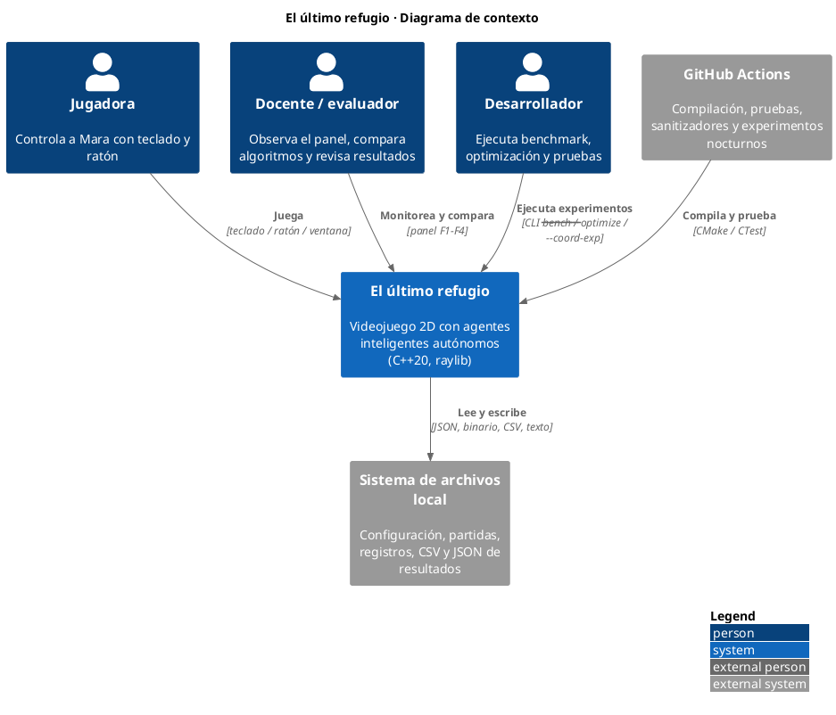
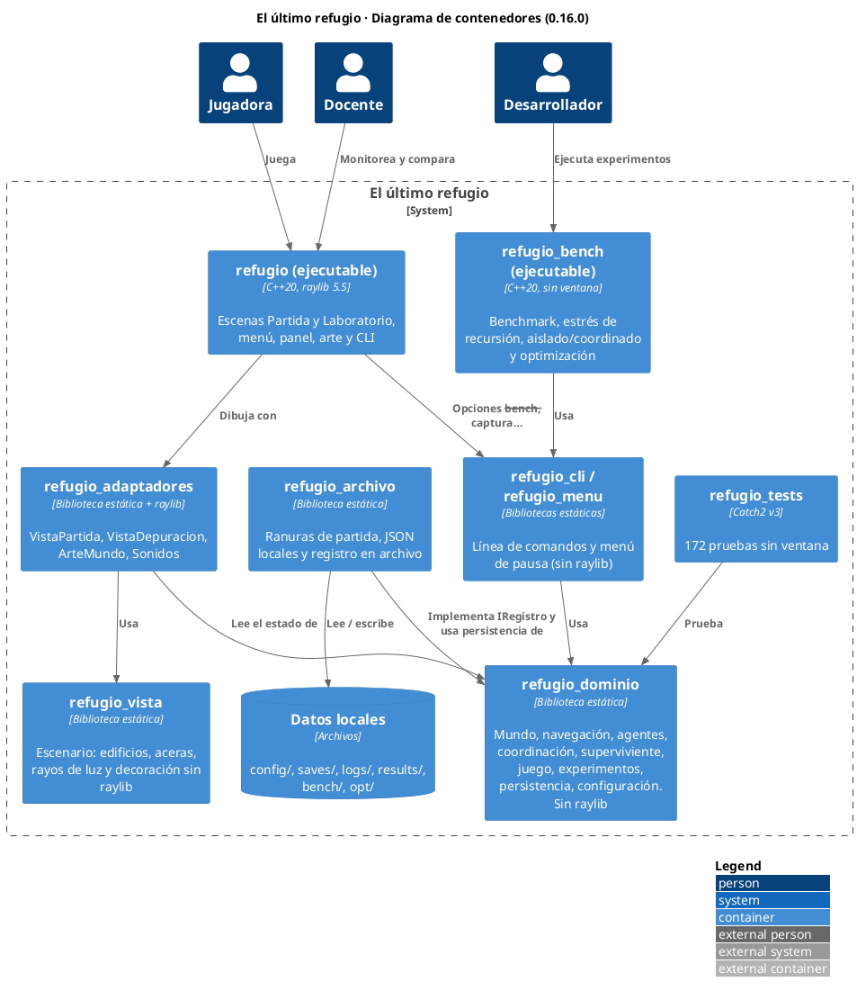
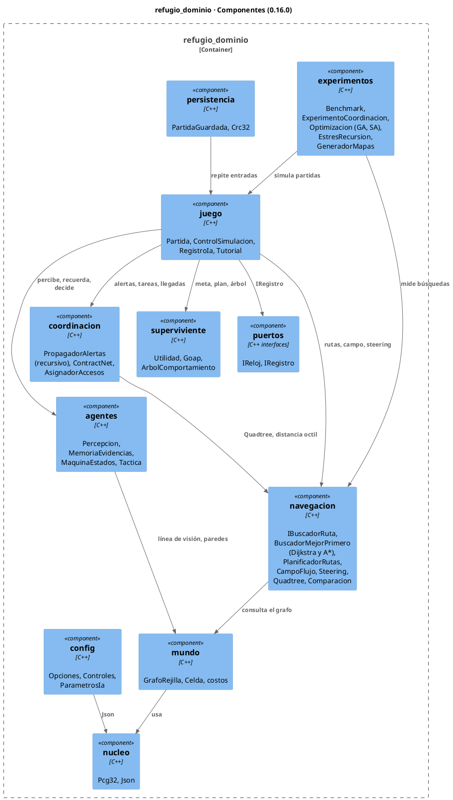
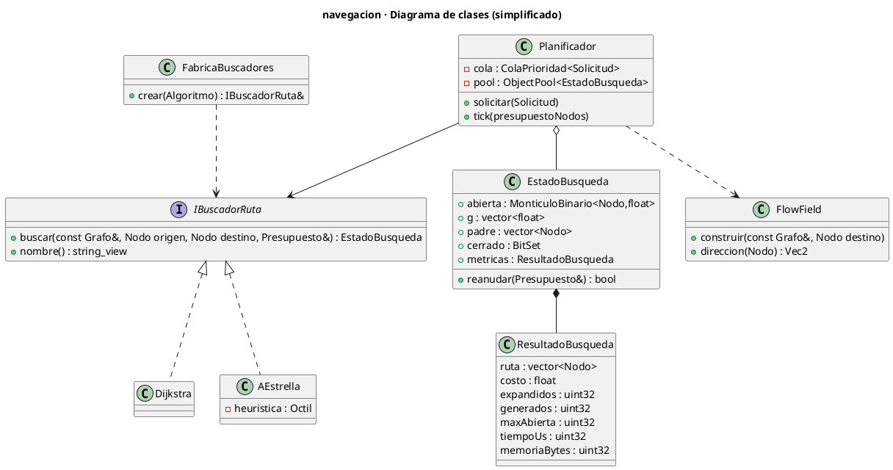
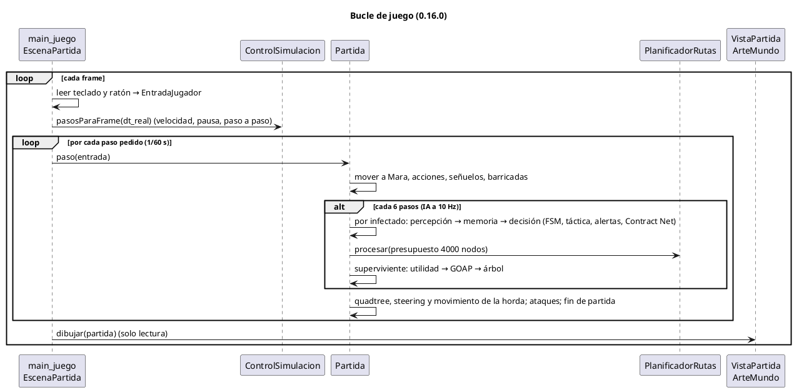
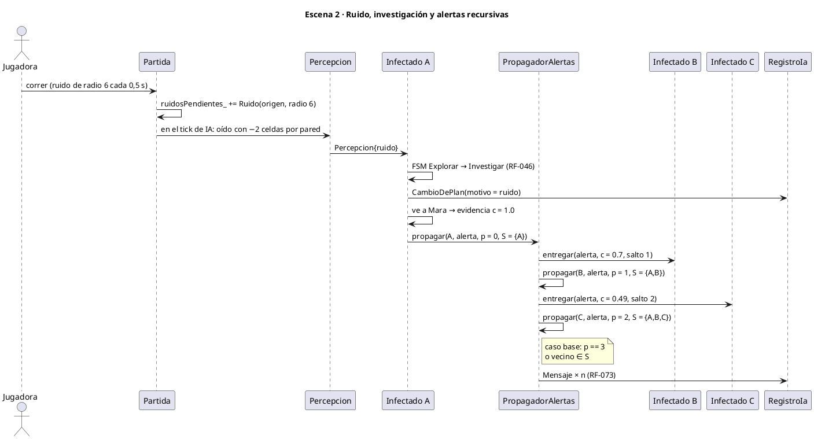
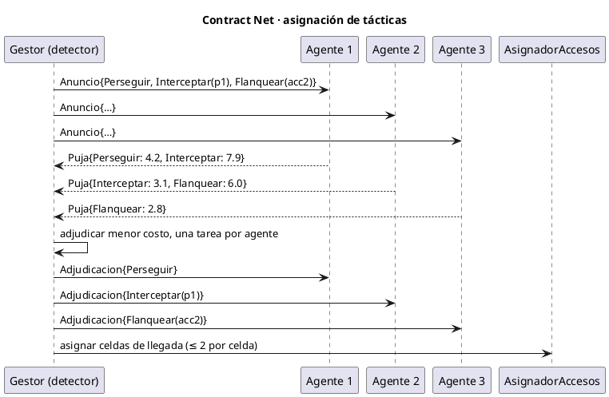
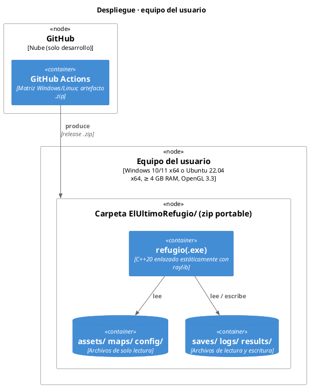
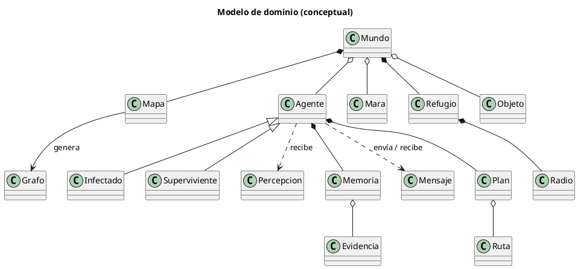

# 07 · Documentación de arquitectura (arc42 + C4)

> Plantilla **arc42** v8 con diagramas del modelo **C4** en PlantUML (biblioteca estándar `C4-PlantUML`).
> Las decisiones se registran como **ADR** en [adr/](adr/README.md).

| Campo | Valor |
|---|---|
| Versión | 0.2.0 (arquitectura implementada en el software 0.16.0) |
| Fecha | 2026-11-25 |
| Estado | Línea base revisada contra la implementación |
| Renderizado de diagramas | `plantuml -tsvg docs/*.md` o la extensión PlantUML de VS Code |

> **Revisión 0.2.0.** Las secciones 2 a 8 describen ahora lo que está en el código de 0.16.0. Los cambios
> respecto de la línea base 0.1.0 son tres decisiones registradas como ADR: el estado vive en `Partida` sin ECS
> ni bus de eventos ([ADR-0018](adr/ADR-0018-estado-en-partida-sin-ecs.md)), los mapas se generan por código
> ([ADR-0019](adr/ADR-0019-mapas-generados.md)) y la interfaz y la calidad usan menos herramientas de las
> previstas ([ADR-0020](adr/ADR-0020-herramientas-reales.md)). La arquitectura hexagonal, el bucle de paso fijo
> y todos los algoritmos se mantienen.

---

## 1. Introducción y metas

### 1.1 Resumen de requisitos

El último refugio es un juego 2D de vista cenital donde Mara reúne medicamentos, combustible y una batería
para activar una radio y escapar, mientras una horda de infectados autónomos la busca usando solo lo que
percibe, recuerda y se comunica. Los requisitos clave son:

| Requisito clave | Referencia |
|---|---|
| Ciclo de agente completo y observable, sin omnisciencia | RF-040, RF-041, RF-070 |
| Dijkstra y A\* sobre el mismo grafo, comparables en vivo y en benchmark | RF-020 a RF-024, RF-074, RF-080 |
| Recursión acotada: propagación de alertas con visitados | RF-047, RNF-027 |
| Coordinación: Contract Net y distribución de aproximaciones | RF-049, RF-051 |
| Replanificación ante señuelos y barricadas | RF-025, RF-050, RF-052 |
| Experimentos reproducibles | RF-080 a RF-086, RNF-020 |
| Bajo consumo en equipos modestos | RNF-001 a RNF-008 |

### 1.2 Metas de calidad (top 5)

| Prioridad | Meta | Escenario | RNF |
|---|---|---|---|
| 1 | **Eficiencia**: fluido en un portátil de 4 GB con 100 agentes | QS-01, QS-05 | RNF-001 a RNF-006 |
| 2 | **Corrección y reproducibilidad** de algoritmos y experimentos | QS-02, QS-03 | RNF-019, RNF-020 |
| 3 | **Observabilidad** de las decisiones de los agentes | — | RF-070 a RF-073, RNF-018 |
| 4 | **Mantenibilidad y capacidad de prueba** del dominio de IA | QS-04 | RNF-023 a RNF-026 |
| 5 | **Fiabilidad** frente a datos locales inválidos | QS-06 | RNF-015 a RNF-017 |

### 1.3 Partes interesadas

Ver [StRS §1.6](01_vision_StRS.md). Para esta arquitectura, el docente espera ver la separación entre
el agente y el motor, y el equipo espera poder probar la IA sin abrir ventana.

---

## 2. Restricciones

| Tipo | Restricción | Motivo |
|---|---|---|
| Técnica | C++20 (el dominio se limita a C++17 + `<span>`/`<concepts>` opcionales) | RES-01, ADR-0002 |
| Técnica | raylib 5.5 (sin raygui); OpenGL 3.3 | RES-02, ADR-0002, ADR-0020 |
| Técnica | Mapas generados con semilla; JSON de configuración con lector propio | ADR-0019 |
| Técnica | Sin red, sin backend, sin nube | RES-05, ADR-0011 |
| Técnica | Dominio sin dependencias de raylib ni del SO | RES-06, ADR-0003 |
| Organizativa | Equipo pequeño, un semestre, herramientas libres | StRS §1.4 |
| Organizativa | Git + GitHub Actions; ramas `main` y `feature/*`; PR con revisión | RES-10 |
| Convención | Código y comentarios en español para el dominio; identificadores sin tildes; `snake_case` para archivos, `PascalCase` para tipos, `camelCase` para funciones | Equipo |
| Convención | `-Wall -Wextra -Werror` (GCC/Clang) y `/W4` (MSVC); comentarios Doxygen en las cabeceras, sin generar | RNF-025, ADR-0020 |

---

## 3. Contexto y alcance

### 3.1 Contexto de negocio (C4 · Nivel 1: contexto del sistema)



| Socio | Entrada al sistema | Salida del sistema |
|---|---|---|
| Jugadora | Teclas, ratón | Imagen 2D, sonido, HUD |
| Docente | Selección de agente, F1–F4, pausa, paso | Panel, superposiciones, registro |
| Desarrollador | Archivos de configuración de experimentos | CSV y JSON de resultados |
| Sistema de archivos | Configuración, partidas | Partidas, registros, resultados |

### 3.2 Contexto técnico

| Canal | Tecnología | Dónde |
|---|---|---|
| Ventana, entrada, render, audio | raylib 5.5 (GLFW + OpenGL 3.3, miniaudio) | `src/adaptadores/raylib/*`, `src/app/main_juego.cpp` |
| Panel, menú y HUD | raylib (`DrawText`, rectángulos) | `VistaPartida`, `VistaDepuracion`, `app/MenuPausa` |
| Mapas | Generados con PCG32 y semilla | `juego::crearEscenarioAleatorio`, `experimentos::GeneradorMapas` |
| Configuración | JSON con lector propio | `dominio/nucleo/Json`, `dominio/config/Configuracion`, `adaptadores/archivo/ArchivosLocales` |
| Partidas | Binario `REFG` + CRC32, inicio + entradas | `dominio/persistencia/PartidaGuardada`, `adaptadores/archivo/ArchivosLocales` |
| Registros | Texto UTF-8, `tick⇥tipo⇥agente⇥campos` | `juego::RegistroIa`, `adaptadores/archivo/RegistroArchivo` |
| Resultados | CSV con cabecera `#` y JSON | `dominio/experimentos/*`, `app/Cli` |

---

## 4. Estrategia de solución

| Meta / problema | Enfoque | ADR |
|---|---|---|
| Separar la IA del motor y probarla sin ventana | **Arquitectura hexagonal**: `refugio_dominio` sin raylib; adaptadores de raylib y de archivos | ADR-0003 |
| Muchas entidades con poco costo | Estado en `Partida` con **arreglos por tipo** reservados al crear la partida; sistemas como métodos en orden fijo | ADR-0018 (sustituye a ADR-0004) |
| Simulación estable y determinista | **Game Loop con paso fijo** (60 Hz) e IA a 10 Hz; control de pausa y velocidad sobre el acumulador | ADR-0005 |
| Búsqueda comparable y óptima | Grafo implícito 8-conexo, **Strategy** `IBuscadorRuta` con Dijkstra y A\* octil | ADR-0006 |
| Muchas búsquedas por tick | **A\* reanudable** con presupuesto de nodos y cola por prioridad + **campo de flujo** compartido | ADR-0007 |
| Decisiones explicables | **FSM** + tácticas por utilidad (infectados); **Utility + GOAP + BT** (superviviente) | ADR-0008 |
| Coordinación y recursividad | **Contract Net** + propagación **recursiva** acotada de alertas | ADR-0009 |
| Consultas de vecinos | **Quadtree** reconstruido en cada paso | ADR-0010 |
| Ligero y local | JSON para configuración, binario con CRC para partidas, sin red | ADR-0011, ADR-0016 |
| Reproducibilidad | PCG32 con semilla y flujos; huella de estado; partida guardada como repetición | ADR-0012, ADR-0016 |
| Optimizar parámetros | GA y recocido simulado sin ventana sobre el mismo dominio | ADR-0015 |
| Mapas variados | Ciudad y mapas de benchmark generados con semilla | ADR-0019 |
| Arte sin recursos externos | Sprites y luz 2D generados por código; la vista no toca la simulación | ADR-0017 |
| Calidad continua | Catch2, ASan/UBSan, comprobación de dependencias y de trazabilidad en CI | ADR-0014, ADR-0020 |

---

## 5. Vista de bloques

### 5.1 Nivel C4 2 · Contenedores



### 5.2 Nivel C4 3 · Componentes del dominio



| Componente | Responsabilidad | Interfaz principal | RF |
|---|---|---|---|
| `nucleo` | PRNG con flujos y lector JSON con errores descriptivos | `Pcg32`, `leerJson()` | RF-086, RF-093 |
| `mundo` | Rejilla, grafo implícito 8-conexo, costos y barricadas | `GrafoRejilla::vecinos()`, `costo()` | RF-004, RF-014, RF-020, RF-031 |
| `navegacion` | Búsqueda, cola con presupuesto, campo de flujo, steering, quadtree, comparación | `IBuscadorRuta`, `PlanificadorRutas::procesar()` | RF-021 a RF-030, RF-074 |
| `agentes` | Visión y oído, memoria de evidencias, FSM y tácticas | `ve()`, `oye()`, `MemoriaEvidencias`, `decidirTransicion()` | RF-041 a RF-046, RF-053, RF-054 |
| `coordinacion` | Alertas recursivas, Contract Net, reparto de accesos | `PropagadorAlertas::propagar()`, `ContractNet` | RF-047, RF-049, RF-051 |
| `superviviente` | Utility, GOAP, árbol de comportamiento | `elegirMeta()`, `Goap::planificar()`, `ArbolComportamiento` | RF-060 a RF-062 |
| `juego` | Estado y reglas de la partida, ciclo de los agentes, registro, control y tutorial | `Partida::paso()`, `ControlSimulacion` | RF-002 a RF-017, RF-040, RF-050, RF-052, RF-055, RF-056, RF-063, RF-064, RF-070 a RF-075 |
| `experimentos` | Benchmark, aislado/coordinado, GA, SA, estrés | `ejecutarBenchmark()`, `ejecutarExperimentoCoordinacion()` | RF-080 a RF-085 |
| `persistencia` | Codificar, validar y repetir partidas | `instantanea()`, `codificar()`, `cargar()` | RF-090, RF-091, RF-093 |
| `config` | Leer y validar `config/*.json` | `leerOpciones()`, `leerControles()`, `leerParametrosIa()` | RF-092, RF-093 |
| `puertos` | Contratos con el exterior | `IReloj`, `IRegistro` | — |

### 5.3 Nivel C4 3 · Componentes de adaptadores y aplicación

| Componente | Biblioteca | Notas |
|---|---|---|
| `adaptadores/archivo/ArchivosLocales` | `refugio_archivo` | Ranuras `saves/slotN.sav` (temporal + renombrado), lectura y escritura de `config/*.json` |
| `adaptadores/archivo/RegistroArchivo` | `refugio_archivo` | Implementa `IRegistro`: `logs/ia_<semilla>.log`; si no puede crear la carpeta, el juego sigue sin archivo |
| `adaptadores/vista/Escenario` | `refugio_vista` | Clasifica la ciudad y calcula rayos de luz y decoración con un hash propio (no usa el PCG32 de la partida) |
| `adaptadores/raylib/VistaPartida` | `refugio_adaptadores` | Mapa, panel lateral, monitor del agente, consola de IA, tutorial y fin de partida |
| `adaptadores/raylib/ArteMundo` | `refugio_adaptadores` | Sprites de 16 px y luz 2D con sombras generados por código (ADR-0017) |
| `adaptadores/raylib/VistaDepuracion` | `refugio_adaptadores` | Laboratorio de rutas (Tab) |
| `adaptadores/raylib/Sonidos` | `refugio_adaptadores` | Efectos generados en memoria |
| `app/main_juego` | `refugio` | Bucle de paso fijo, escenas `EscenaPartida` y `EscenaLaboratorio`, cámara y captura |
| `app/MenuPausa` | `refugio_menu` | Menú Esc: guardar, cargar, opciones y controles (sin raylib, probado en CP-112 y CP-114) |
| `app/Cli` | `refugio_cli` | `--bench`, `--estres-recursion`, `--coord-exp`, `--optimize`; compartido por `refugio` y `refugio_bench` |

### 5.4 Estructura del repositorio

```text
ElUltimoRefugio/
├── CMakeLists.txt, CMakePresets.json   # presets debug, release, headless, asan
├── cmake/                     # Dependencias.cmake (FetchContent: raylib 5.5, Catch2 v3.7.1), Opciones.cmake
├── src/
│   ├── dominio/               # refugio_dominio (sin raylib, comprobado por tools/check_deps.sh)
│   │   ├── nucleo/  mundo/  navegacion/  agentes/  coordinacion/  superviviente/
│   │   ├── juego/  experimentos/  persistencia/  config/  puertos/
│   ├── adaptadores/
│   │   ├── archivo/           # refugio_archivo
│   │   ├── vista/             # refugio_vista (sin raylib)
│   │   └── raylib/            # refugio_adaptadores
│   └── app/                   # main_juego.cpp, main_bench.cpp, Cli, MenuPausa
├── tests/  unit/  data/       # refugio_tests (Catch2)
├── bench/  opt/  config/      # configuración de benchmark, optimización e IA
├── tools/                     # check_deps.sh, resumen_bench.py, trazabilidad.py
├── assets/  maps/             # vacías: el arte y los mapas se generan por código
├── .github/workflows/         # ci.yml (cada push y PR), rendimiento.yml (nocturno)
└── docs/                      # esta documentación y adr/
```

### 5.5 Nivel C4 4 · Código: búsqueda de rutas (Strategy)



El diagrama es el diseño de la línea base; los nombres reales están en el párrafo «Implementación». No existen
`FabricaBuscadores` ni el `ObjectPool`: `Partida` tiene un `BuscadorMejorPrimero` por algoritmo y elige uno con F2.

Dijkstra se implementa como A\* con h ≡ 0 sobre el mismo `EstadoBusqueda`, lo que garantiza que ambos usan
la misma estructura de datos y la comparación solo mide el efecto de la heurística.

**Implementación (0.15.0, HU-23).** El estado reanudable vive dentro de `BuscadorMejorPrimero`
(`iniciar()` / `avanzar(maxExpansiones)` / `estado()`, con `EstadoBusqueda` = `EnCurso`, `Encontrada` o
`SinRuta`), y `navegacion::PlanificadorRutas` hace de `Planificador`: cola de solicitudes por agente
ordenada por prioridad efectiva = prioridad + espera / 5 ticks, y una sola búsqueda a medias a la vez. Por
eso no hace falta el `ObjectPool<EstadoBusqueda>` del diseño: la memoria es O(V) y no O(V · agentes), y
como las búsquedas se encadenan dentro del tick, el presupuesto se aprovecha entero. El presupuesto
cuenta nodos y no tiempo, así que el reparto es el mismo en cualquier equipo (RNF-020).

---

## 6. Vista de ejecución

### 6.1 Bucle de juego con paso fijo



Todos los infectados piensan en el mismo paso de IA (cada 6 pasos de simulación); el presupuesto de nodos de
`PlanificadorRutas` reparte las búsquedas largas entre varios ticks de IA en lugar de escalonar a los agentes por
grupos. No hay interpolación de render: la vista dibuja el último estado (RNF-002, RNF-020).

### 6.2 Ruido y propagación recursiva de alertas (Escena 2)



### 6.3 Contract Net y distribución de aproximaciones (Escenas 3 y 5)



### 6.4 Señuelo y barricada (prueba de aceptación del docente)

1. La jugadora pulsa Q: `Partida` coloca el señuelo en uno de los 4 huecos del arreglo `senuelos_` y genera
   un `Ruido` de radio 8 cada segundo, 10 veces.
2. Solo los infectados que lo oyen (radio menos 2 celdas por pared) lo reciben en su percepción. Cada uno calcula
   U(señuelo) frente a U(objetivo actual) con su memoria (RF-050); quien ve a Mara no se distrae.
3. Si cambia el objetivo, el agente pide una ruta a `PlanificadorRutas` y se registra un cambio de plan con
   ambas utilidades (RF-072).
4. La jugadora pulsa B: la celda pasa a no transitable y aumenta la versión del mapa (`CambioDeMapa`); el campo
   de flujo se recalcula y la búsqueda a medias empieza de nuevo (RF-025).
5. El infectado que **ve** la barricada en su ruta replanifica; si el rodeo cuesta más del doble o no existe,
   pasa a `AtacarBarricada` (RF-052). El que no la ve sigue con su ruta hasta verla.

### 6.5 Benchmark sin ventana

`refugio_bench` (o `refugio --bench`) → `app/Cli` lee la configuración JSON y las opciones → `Benchmark`
genera mapas con la semilla (`GeneradorMapas`), fija pares origen-destino, ejecuta Dijkstra y A\* `reps` veces
cada uno reutilizando el mismo `ResultadoBusqueda`, mide con `std::chrono::steady_clock`, verifica la
optimalidad (RF-082, código de salida 2) y escribe el CSV con cabecera de metadatos (RF-081). Los experimentos
`--coord-exp` y `--optimize` simulan `Partida` completas sin ventana con el mismo dominio.

---

## 7. Vista de despliegue



* No se instala nada: se compila con CMake y se ejecuta (RNF-028). El `.zip` portable de la figura todavía no
  se genera en CI.
* `config/`, `saves/`, `logs/` y `results/` se crean junto a donde se ejecuta el juego. La carpeta alternativa
  de datos de usuario para carpetas de solo lectura no está implementada (RNF-010).
* `assets/` y `maps/` están vacías: el arte, el sonido y los mapas se generan al iniciar.

---

## 8. Conceptos transversales

### 8.1 Modelo de dominio



El modelo es conceptual. En el código, `Mundo` y `Mapa` son `mundo::GrafoRejilla` más los arreglos de
`juego::Partida`; `Agente` no es una clase base: `Infectado` y `SupervivienteRadio` son estructuras de datos
distintas y `Mara` es `juego::Superviviente` (ADR-0018).

### 8.2 Arquitectura del agente

Cada agente implementa el ciclo exigido por la guía (GUIA §4) con un componente por etapa:

| Etapa | Infectado | Superviviente de la radio | Datos |
|---|---|---|---|
| Percepción | `agentes::ve()` (cono + Bresenham) y `oye()` (−2 celdas por pared), alertas y tareas recibidas | Visión de 360° a 8 celdas con línea de visión | `PercepcionInfectado`, `PercepcionMonitor` |
| Memoria y contexto | `MemoriaEvidencias` (16, semivida 10 s) + mapa de visitas en bloques de 4 × 4 | `Hechos` del GOAP, tablas que lleva | evidencias, visitas |
| Decisión | `decidirTransicion()` (FSM) + `Tactica` (utilidad) + `ContractNet` como gestor | `elegirMeta()` (utilidad con histéresis) | estado, objetivo, meta |
| Planificación | `PlanificadorRutas` (A\*/Dijkstra reanudable) o `CampoFlujo` | `Goap::planificar()` (A\* regresivo) + A\* de ruta | `ruta`, `PlanGoap` |
| Ejecución | `Steering` (6 fuerzas) en cada paso de simulación; atacar a Mara, la puerta o una barricada | `ArbolComportamiento` (secuencia, selector, inversor, hojas) | velocidad, acción |
| Evaluación | ¿llegó? ¿evidencia nueva? ¿ruta bloqueada? ¿sin ruta? | ¿acción con éxito? ¿precondición rota? | transición o cambio de plan |
| Actualización | Registro de transiciones, planes y mensajes (`RegistroIa`) | Registro de planes con motivo | `logs/ia_<semilla>.log` |

En `Partida` la decisión va antes de la planificación: el infectado elige estado y objetivo con su percepción y
su memoria, y luego pide la ruta, que puede tardar uno o más ticks de IA si se agota el presupuesto (RF-026).

### 8.3 No omnisciencia por diseño

* Cada infectado decide en `Partida::percibirYDecidir` con su `PercepcionInfectado` (lo que ve y oye en ese
  tick), su `MemoriaEvidencias` y los mensajes que recibió. La posición de Mara solo entra si `ve()` la confirma
  o si llega en una alerta; la de una barricada, solo cuando la ve en su ruta (RF-052).
* `decidirTransicion()` es una función pura de (estado, percepción, contexto) y no recibe el mundo (CP-044).
* Como no hay un módulo de decisión separado del mundo (ADR-0018), la garantía la dan las pruebas: CP-041
  (visión), CP-050 (quien ve a Mara no sigue el señuelo), CP-052 (barricadas) y CP-084 (en aislado, los que
  están tras el muro siguen explorando).

### 8.4 Estado de la simulación y eventos

* El estado está en `juego::Partida`: Mara, `std::vector<Infectado>` (capacidad fija), el superviviente,
  `std::array` de 4 señuelos y 8 barricadas, objetos de misión y anillos de registro. Todo se reserva al crearla.
* Los sistemas son métodos llamados en orden fijo desde `paso()` (ver §6.1).
* Eventos: los `Ruido` se acumulan en un vector reservado y se consumen en el siguiente tick de IA;
  `CambioDeMapa` es la versión del grafo, que invalida rutas, el campo de flujo y la búsqueda a medias.
* La vista (`VistaPartida`, `ArteMundo`) solo lee la partida; seleccionar o comparar agentes no cambia la
  simulación (CP-071, CP-074).

### 8.5 Gestión de memoria y rendimiento

| Técnica | Dónde | RNF |
|---|---|---|
| Capacidad reservada al crear la partida | infectados, rutas, memorias, ruidos, registros; señuelos y barricadas en `std::array` | RNF-006 (CP-106: 0 asignaciones por paso) |
| Texturas generadas una vez | `ArteMundo` pinta la ciudad en una textura por mapa y los sprites al iniciar | RNF-001, RNF-007 |
| Datos contiguos | `EstadoNodo` de 16 bytes por nodo (g, padre, generación, cerrado) indexado por celda | RNF-003, RNF-005 |
| Índice de generación | reinicio O(1) entre búsquedas: un nodo es válido si su generación es la actual | RNF-003 |
| Presupuesto de nodos | 4000 nodos por tick de IA, exacto, con búsquedas reanudables (ADR-0007) | RNF-002 |
| Campo de flujo compartido | 1 Dijkstra inverso para todos los perseguidores (≥ 5 en el juego) | RNF-030 |
| Paralelismo solo fuera del juego | la optimización evalúa candidatos en varios hilos con resultados independientes de su número | RNF-020 |

### 8.6 Complejidad de los algoritmos

V = celdas transitables, E ≤ 8V, n = agentes, k = vecinos promedio, D = profundidad, b = factor de ramificación.

| Algoritmo | Tiempo | Espacio | Notas |
|---|---|---|---|
| Dijkstra (montículo binario) | O((V + E) log V) | O(V) | Pesos ≥ 1 |
| A\* (octil, consistente) | O((V + E) log V) peor caso; en la práctica expande ≤ Dijkstra | O(V) | Sin reapertura |
| Flow field (Dijkstra inverso) | O((V + E) log V) una vez por destino | O(V) | Amortizado entre N agentes |
| Quadtree: construcción / consulta | O(n log n) / O(log n + k) promedio | O(n) | Recursivo, D ≤ 8 |
| Propagación de alertas | O(n · k) | O(D) pila + O(n) bits | Recursiva, D ≤ 3 |
| Contract Net | O(m · t) mensajes, m agentes, t tareas | O(m · t) | 1 ronda |
| Asignación de accesos (voraz) | O(n · s log s) | O(n + s) | s accesos |
| GOAP (A\* regresivo) | O(b^D) peor caso, D ≤ 6 | O(b^D) | Acciones ≤ 12 |
| Árbol de comportamiento | O(nodos) por tick | O(profundidad) pila | Recursivo, D ≤ 10 |
| Visión (Bresenham) | O(r) por objetivo | O(1) | r = radio |
| GA | O(G · P · C) | O(P) | G generaciones, P población, C costo de simular |
| Recocido simulado | O(I · C) | O(1) | I iteraciones |

### 8.7 Determinismo y aleatoriedad

* PCG32 con semilla maestra y flujos independientes: generación de la ciudad (flujo 1), partida, escenario
  dinámico del benchmark (2), estrés de recursión y optimización (constante propia). La decoración del arte usa
  un hash propio y no consume el generador de la partida (ADR-0017).
* El orden de iteración de los sistemas es fijo; no se itera sobre `unordered_map` en lógica de simulación.
* Flotantes: `-ffp-contract=off` y sin `-ffast-math`; la huella de estado (`huellaPartida`, FNV-1a) se
  comprueba al cargar una partida y en el experimento aislado/coordinado.
* El tiempo real solo afecta al acumulador del bucle, nunca a la lógica (RNF-020).

### 8.8 Registro y observabilidad

* `juego::RegistroIa` guarda en un anillo las últimas líneas (transiciones, cambios de plan, planes del
  superviviente y mensajes) para la consola del panel (L) y las pasa a un `IRegistro` opcional;
  `RegistroArchivo` lo escribe en `logs/ia_<semilla>.log`.
* Formato de línea: `tick⇥tipo⇥agente⇥campos…` (ver el README del repositorio).
* El panel muestra además, por tick de IA, nodos expandidos sobre el presupuesto, solicitudes en cola, tiempo
  de búsqueda y la mayor espera de una ruta. No hay perfilador integrado (ADR-0020).

### 8.9 Manejo de errores

* El paso de simulación no lanza excepciones. La lectura de configuración devuelve `Lectura<T>` con el valor
  (o el de defecto) y la lista de errores; la de partidas, `ErrorCarga` con su mensaje; la CLI lanza
  `std::runtime_error` con un texto que dice qué corregir y termina con código distinto de 0.
* Los adaptadores validan toda entrada externa (tamaño, esquema, rangos, CRC) y devuelven errores descriptivos (RF-093).
* Las recursiones llevan su profundidad máxima como parámetro y las pruebas la comprueban (CP-127).

### 8.10 Configuración

`config/juego.json` (ventana, audio, idioma), `config/ia.json` (parámetros de SRS §2, prototipos de agente,
pesos de utilidad y steering en la sección `"pesos"`), `config/controles.json`. La sección `"pesos"` de los resultados de la optimización (RF-085, `results/opt_<ga|sa>_<semilla>.json`) se puede
copiar directamente a `config/ia.json`.

### 8.11 Catálogo de patrones de diseño

| Patrón | Uso | Ubicación |
|---|---|---|
| Game Loop (paso fijo) | Simulación estable y determinista | `app/main_juego`, `juego/ControlSimulacion` |
| State | FSM de infectados; escenas Partida y Laboratorio; menú | `agentes/MaquinaEstados`, `app/main_juego`, `app/MenuPausa` |
| Composite | Árbol de comportamiento | `superviviente/ArbolComportamiento` |
| Strategy | `IBuscadorRuta` (Dijkstra / A\*), fábrica de buscadores inyectable en el benchmark | `navegacion/BuscadorRuta`, `experimentos/Benchmark` |
| Memento / Command | Partida guardada como inicio + entradas por tick que se repiten | `persistencia/PartidaGuardada` (ADR-0016) |
| Observer (ligero) | `IRegistro` recibe las líneas del registro de IA | `puertos/Puertos`, `juego/RegistroIa` |
| Spatial Partition | Quadtree | `navegacion/Quadtree` |
| Ports & Adapters | Aislamiento del dominio | `dominio/puertos`, `adaptadores/` |

### 8.12 Estrategia de pruebas

Ver [05_casos_prueba.md](05_casos_prueba.md) y ADR-0014.

---

## 9. Decisiones de arquitectura

| ADR | Título | Estado |
|---|---|---|
| [ADR-0001](adr/ADR-0001-registrar-decisiones.md) | Registrar decisiones de arquitectura con ADR | Aceptada |
| [ADR-0002](adr/ADR-0002-cpp20-raylib.md) | C++20 con raylib 5 y raygui | Aceptada; raygui sustituido por ADR-0020 |
| [ADR-0003](adr/ADR-0003-arquitectura-hexagonal.md) | Arquitectura hexagonal con dominio de IA puro | Aceptada |
| [ADR-0004](adr/ADR-0004-ecs-bus-eventos.md) | ECS ligero propio y bus de eventos interno | Sustituida por ADR-0018 |
| [ADR-0005](adr/ADR-0005-bucle-paso-fijo.md) | Bucle de juego con paso fijo e IA escalonada | Aceptada; sin grupos ni interpolación |
| [ADR-0006](adr/ADR-0006-grafo-rejilla-heuristica-octil.md) | Grafo implícito 8-conexo y heurística octil | Aceptada |
| [ADR-0007](adr/ADR-0007-astar-iterativo-flow-fields.md) | A\* iterativo con presupuesto y flow fields | Aceptada |
| [ADR-0008](adr/ADR-0008-modelo-decision-hibrido.md) | FSM para infectados; Utility + GOAP + BT para el superviviente | Aceptada; sin Blackboard |
| [ADR-0009](adr/ADR-0009-coordinacion-contract-net-alertas.md) | Contract Net y propagación recursiva acotada de alertas | Aceptada |
| [ADR-0010](adr/ADR-0010-quadtree.md) | Quadtree como partición espacial | Aceptada |
| [ADR-0011](adr/ADR-0011-persistencia-local.md) | Persistencia solo local: JSON y binario con CRC | Aceptada; concretada en ADR-0016 |
| [ADR-0012](adr/ADR-0012-determinismo-pcg32.md) | Determinismo con PCG32 y hash de estado | Aceptada |
| [ADR-0013](adr/ADR-0013-mapas-tiled-json.md) | Mapas Tiled en JSON con nlohmann/json | Sustituida por ADR-0019 |
| [ADR-0014](adr/ADR-0014-estrategia-calidad.md) | Catch2, sanitizadores, Tracy y CI | Aceptada; modificada por ADR-0020 |
| [ADR-0015](adr/ADR-0015-optimizacion-ga-sa.md) | Optimización offline con algoritmo genético y recocido simulado | Aceptada |
| [ADR-0016](adr/ADR-0016-guardado-por-repeticion.md) | Guardar la partida como inicio + entradas y repetirla al cargar | Aceptada |
| [ADR-0017](adr/ADR-0017-arte-pixel-iluminacion.md) | Arte pixel generado por código con luz 2D y sombras | Aceptada |
| [ADR-0018](adr/ADR-0018-estado-en-partida-sin-ecs.md) | Estado de la simulación en `Partida` con arreglos por tipo, sin ECS | Aceptada |
| [ADR-0019](adr/ADR-0019-mapas-generados.md) | Mapas generados por código con semilla y lector JSON propio | Aceptada |
| [ADR-0020](adr/ADR-0020-herramientas-reales.md) | Ajustar la interfaz y la estrategia de calidad a las herramientas usadas | Aceptada |

---

## 10. Requisitos de calidad

### 10.1 Árbol de calidad

```text
Calidad
├── Eficiencia de desempeño
│   ├── Comportamiento temporal ── RNF-001, RNF-002, RNF-003, RNF-008, RNF-018
│   ├── Utilización de recursos ── RNF-004, RNF-005, RNF-006, RNF-007
│   └── Capacidad ──────────────── RNF-027
├── Adecuación funcional ───────── RNF-019, RNF-020, RNF-032
├── Fiabilidad ─────────────────── RNF-015, RNF-016, RNF-017
├── Mantenibilidad ─────────────── RNF-023, RNF-024, RNF-025, RNF-026
├── Capacidad de interacción ───── RNF-011, RNF-012, RNF-013, RNF-014
├── Compatibilidad ─────────────── RNF-009, RNF-010
├── Seguridad ──────────────────── RNF-021, RNF-022
├── Flexibilidad ───────────────── RNF-028, RNF-029, RNF-030
└── Protección ─────────────────── RNF-031
```

### 10.2 Escenarios de calidad

Ver [04_requisitos_no_funcionales.md §12](04_requisitos_no_funcionales.md) (QS-01 a QS-06).

---

## 11. Riesgos y deuda técnica

| ID | Riesgo | Prob. | Impacto | Mitigación | Disparador |
|---|---|---|---|---|---|
| RT-01 | GOAP excede el tiempo de desarrollo | Media | Medio | Es `S`; el BT con utilidad cubre el superviviente si GOAP se retrasa | Semana 8 sin GOAP estable |
| RT-02 | Comportamiento oscilante entre objetivos | Alta | Medio | Histéresis, tiempo mínimo en estado, utilidad con decaimiento | Más de 3 cambios/s en el registro |
| RT-03 | El determinismo se rompe entre compiladores | Media | Medio | Se exige determinismo por binario; se documentan las opciones de punto flotante | CP-120 falla en CI |
| RT-04 | Contract Net genera tráfico excesivo con hordas grandes | Media | Medio | Una ronda por detección, gestor único por evidencia, límite de m ≤ 16 | > 500 mensajes/s |
| RT-05 | raylib en GPU antigua sin OpenGL 3.3 | Baja | Alto | Compilar alternativa con `GRAPHICS_API_OPENGL_21` | Prueba en equipo del evaluador |
| RT-06 | Diferencias Dijkstra/A\* pequeñas en mapas abiertos | Media | Bajo | Incluir mapas tipo laberinto y ciudad densa en el benchmark | — |

Seguimiento en 0.16.0: RT-01 no ocurrió (GOAP estable desde 0.8.0); RT-02 se controla con histéresis en las
tácticas (10 %) y en las metas del superviviente (0,1); RT-03 se acota exigiendo la misma versión del juego para
cargar una partida (ADR-0016); RT-04 no se ha observado con 10 infectados ni en el experimento de 100.

Deuda técnica en 0.16.0:

| ID | Deuda | Efecto | Prioridad |
|---|---|---|---|
| DT-01 | Sin medición de FPS, tiempo de tick completo, CPU ni arranque (Tracy y scripts de `tools/`) | RNF-001, RNF-002, RNF-004, RNF-008 sin verificar | Alta para el informe final |
| DT-02 | RF-001, RF-006, RF-015 y RF-048 sin implementar | HU-01, HU-02 y HU-08 con pendientes | Media |
| DT-03 | `Partida.cpp` concentra la horda, las herramientas de Mara y el ciclo de IA (≈ 1350 líneas) | Más difícil de leer y de extender (RNF-026) | Media |
| DT-04 | Sin cobertura, MinGW ni libFuzzer en CI | RNF-009, RNF-016 y RNF-024 parciales | Baja |
| DT-05 | Ventana fija sin escalado y sin `.zip` portable | RNF-028 y RNF-029 | Baja |
| DT-06 | Sin editor de escenarios | — | Fuera de alcance |

---

## 12. Glosario

Ver [StRS §1.5](01_vision_StRS.md). Términos adicionales:

| Término | Definición |
|---|---|
| Puerto | Interfaz del dominio que define una necesidad hacia el exterior. |
| Adaptador | Implementación concreta de un puerto o de la vista (raylib, archivos). |
| Flow field | Campo vectorial que indica en cada celda la dirección hacia un destino. |
| Contract Net | Protocolo de negociación de tareas con anuncio, puja y adjudicación. |
| GOAP | Goal-Oriented Action Planning: planificación de acciones por búsqueda en el espacio de estados. |
| Utility AI | Selección de acciones por puntuación de utilidad. |
| Sparse set | Estructura de dos arreglos con inserción, borrado y búsqueda O(1). Era la base del ECS previsto (ADR-0004, sustituido). |
