# El último refugio · Informe final

**Algoritmos Computacionales · Fundación Universitaria de Popayán**
Proyecto final 2: *apocalipsis zombi y coordinación*. Versión del juego **0.16.0** (commit `9469143`) para
las mediciones; la versión **0.18.0** completa los cuatro requisitos que quedaban pendientes (§2.1).
Fecha del informe: 26 de noviembre de 2026.

## Resumen

*El último refugio* es un videojuego 2D de vista cenital en C++20 y raylib 5. Mara reúne medicamentos,
combustible y una batería, activa la radio del refugio y huye por una extracción temporal, mientras una
horda de infectados la busca **sin información global**: cada uno ve, oye, recuerda, se comunica con sus
vecinos y decide. Un superviviente aliado defiende el refugio con utilidad, GOAP y un árbol de
comportamiento.

Los resultados principales, medidos para este informe con la versión 0.16.0, son:

| Resultado | Valor | Sección |
|---|---|---|
| Optimalidad de A\* (heurística octil) | 400 de 400 consultas con el mismo costo que Dijkstra; 0 consultas con más nodos | §6.2 |
| Ahorro de nodos de A\* frente a Dijkstra | 81 % (32²) a 88 % (256²) | §6.2 |
| A\* en 128² con 25 % de obstáculos | mediana 127 µs, p95 747 µs (umbral 1 ms) | §6.2, §9 |
| Escenario dinámico (barricada en la ruta) | 400 de 400 recorridos replanifican y llegan | §6.3 |
| Horda coordinada frente a aislada (10 pares) | rodea a Mara con 7,5 infectados frente a 5,3 (p = 0,02) | §7 |
| Optimización GA / SA | aptitud 0,42 → 1,41 (GA) y 1,36 (SA); pesos no adoptados | §8 |
| Pruebas automáticas | 198 de 198 pasan en 0.18.0 (Catch2 + CTest) | §10 |
| Memoria del benchmark (RSS pico) | 13,1 MB (umbral 64 MB) | §9 |

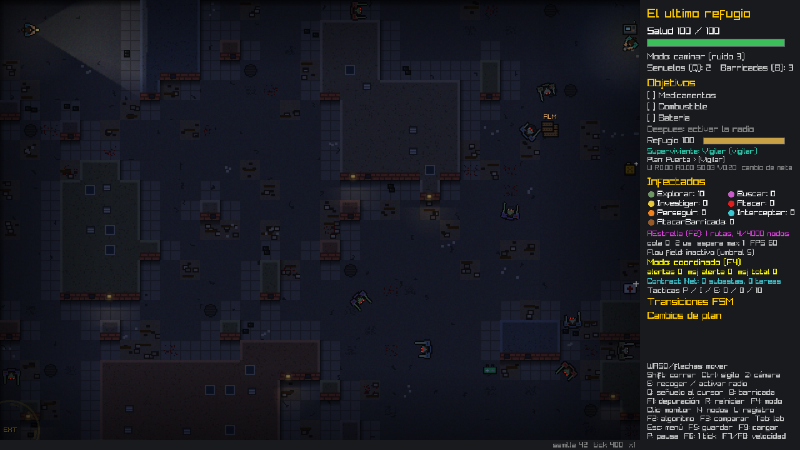

## 1. Objetivo y alcance

La guía del curso pide «desarrollar un videojuego que integre algoritmos computacionales y arquitecturas
de agentes inteligentes autónomos para resolver problemas de navegación, planificación, optimización y
toma de decisiones en entornos dinámicos». El storyboard del proyecto 2 añade cinco escenas (ciudad
silenciosa, farmacia, horda, refugio y extracción), la comparación de agentes aislados y coordinados con
la misma semilla, la propagación recursiva de alertas y una prueba de aceptación con señuelo y barricada.

Este informe reúne lo que se construyó y, sobre todo, **lo que se midió**. La especificación completa está
en `docs/` (visión, 23 historias de usuario, 68 RF, 32 RNF, 104 casos de prueba, matriz de trazabilidad,
arquitectura arc42 y 20 ADR); aquí se resume y se remite a ella.

## 2. El juego y cómo ejecutarlo

**Objetivo**: recoger los tres objetos, mantener E en la radio 8 s y entrar en la extracción mientras está
abierta (60 s). **Derrota**: salud 0 («Mara ha caído») o integridad del refugio 0.

**Mecánicas que provocan decisiones de la IA**: tres modos de movimiento con distinto ruido (sigilo,
caminar, correr), señuelos sonoros (Q), barricadas (B), la instalación ruidosa de la radio y la extracción
en el otro extremo de la ciudad.

**Compilar y ejecutar** (raylib y Catch2 se descargan solos):

```bash
cmake --preset release && cmake --build --preset release
ctest --test-dir build/release --output-on-failure
./build/release/refugio            # Windows: .\build\Release\refugio.exe
```

Teclas para la demostración: **F1** depuración (estados, conos, rutas, campo de flujo), **clic** en un
infectado para su monitor, **F2** Dijkstra/A\*, **F3** comparación de la última consulta, **F4**
aislado/coordinado, **L** registro de IA, **P/F6/F7/F8** pausa, paso a paso y velocidad, **Tab**
laboratorio. La lista completa está en el `README.md`.

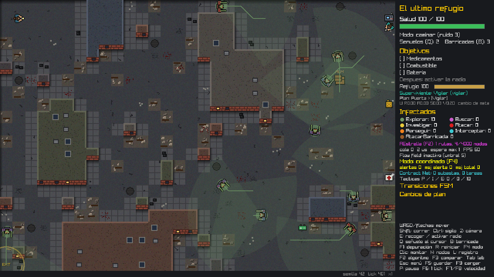

### 2.1 Novedades de 0.18.0: los cuatro RF pendientes

| RF | Qué hace | Cómo se ve en la demostración |
|---|---|---|
| RF-001 Mapas de Tiled | `refugio --mapa-tiled maps/puerto.json` carga un mapa de Tiled 1.10 (capas `suelo`, `colision`, `costo`, `objetos`, `spawns`, `zonas`) y construye el mismo escenario que el generador (ADR-0019). Un mapa inválido da un error con la capa y el objeto, y se juega en la ciudad generada. | El puerto de ejemplo: 8 puertas, 7 infectados con su rol y el refugio en el centro. |
| RF-006 Puerta metálica | Cierra un hueco de muro o una calle estrecha; Mara la abre con E y el chirrido es un ruido de radio 10 que la horda oye y va a investigar. Los infectados no abren puertas. | Plancha de acero remachada; con F1 se ve el radio del ruido y a la horda cambiar a Investigar. |
| RF-015 Medicamento | C suma 35 de salud sin pasar de 100; siempre queda un medicamento para la radio. La ciudad generada trae dos de más. | El panel dice «+N para curarse». |
| RF-048 Roles | Explorador (visión 7 celdas y 110°, 2 celdas/s) y perseguidor (visión 90°, el más rápido), leídos de `prototipos` en `config/ia.json`. Uno de cada tres es explorador. | Exploradores más pálidos con ojos amarillos; F1 dibuja el cono de cada rol y el monitor dice el rol. |

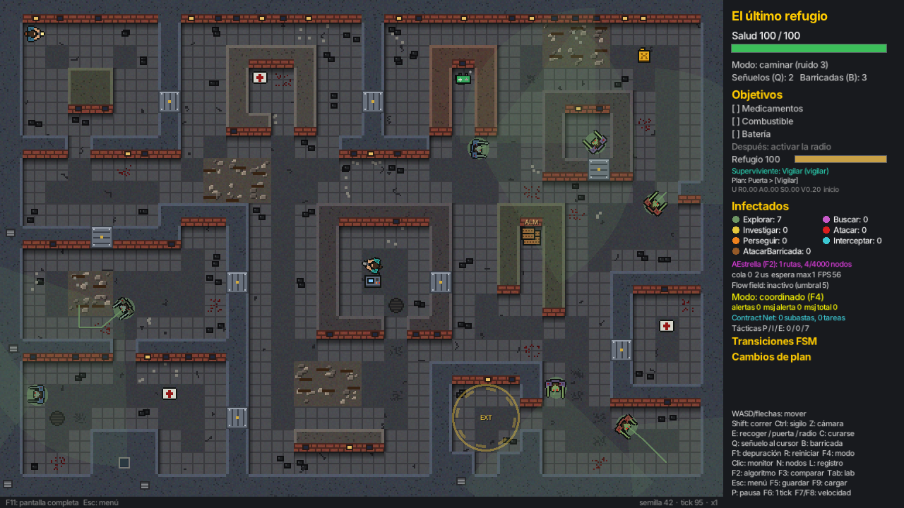

Las cifras de §6 a §8 se midieron con 0.16.0, antes de estos cambios. Los roles y las puertas cambian la
horda de la ciudad generada, así que repetir el experimento de §7 y la optimización de §8 con 0.18.0 daría
números algo distintos (el benchmark de §6 no cambia: usa sus propios mapas y no tiene infectados).

## 3. Arquitectura de agentes

### 3.1 Ciclo del agente

Cada agente recorre el ciclo de la guía (§4) en cada tick de IA (10 Hz, sobre una simulación de paso fijo a
60 Hz, ADR-0005):

| Etapa | Infectado | Superviviente de la radio |
|---|---|---|
| Percepción | Cono de visión con línea de visión (Bresenham); oído con −2 celdas de alcance por pared; alertas y tareas recibidas | Visión de 360° a 8 celdas |
| Memoria y contexto | Hasta 16 evidencias (avistamiento, ruido, alerta) con semivida de 10 s; mapa de visitas propio | Hechos del planificador; tablas que lleva |
| Decisión | Máquina de estados + utilidad de tácticas (perseguir, interceptar, explorar) con histéresis | Utilidad de 4 metas con histéresis de 0,1 |
| Planificación | A\* o Dijkstra reanudable con presupuesto, o campo de flujo compartido | GOAP (A\* regresivo, ≤ 6 acciones) + A\* de ruta |
| Ejecución | Steering con 6 fuerzas; atacar a Mara, la puerta o una barricada | Árbol de comportamiento |
| Evaluación | ¿llegó? ¿evidencia nueva? ¿ruta bloqueada? ¿sin ruta? | ¿acción con éxito? ¿precondición rota? |
| Actualización | Registro de transiciones, cambios de plan y mensajes con su motivo | Registro de planes con motivo |

Estados del infectado: Explorar, Investigar, Perseguir, Buscar, Atacar, Interceptar y AtacarBarricada.

### 3.2 Sin omnisciencia

La posición de Mara solo entra en la decisión de un infectado si la ve o si le llega en una alerta; una
barricada, solo cuando la ve en su ruta. `decidirTransicion()` es una función pura de (estado, percepción,
contexto) y no recibe el mundo. Las pruebas CP-041 (visión), CP-050 (quien ve a Mara no sigue el señuelo),
CP-052 (barricadas) y CP-084 (en modo aislado, los que están tras un muro siguen explorando) lo verifican.

### 3.3 Arquitectura de software

Hexagonal (ADR-0003): el dominio de IA (`src/dominio/`, biblioteca `refugio_dominio`) no incluye raylib ni
E/S, y se prueba y se ejecuta sin ventana (`refugio_bench`). La simulación es **determinista** (PCG32 con
semilla, orden fijo, sin `-ffast-math`, ADR-0012): la misma semilla y las mismas entradas dan la misma huella
de estado, lo que permite guardar la partida como sus entradas (ADR-0016) y comparar modos en pares exactos.
El código son 82 archivos y unas 11 400 líneas de C++ en `src/`.

### 3.4 Panel de monitoreo

El panel (guía §6) muestra, para el agente seleccionado, estado, objetivo, percepción del último ciclo,
ruta, algoritmo, heurística, costo, nodos expandidos y generados, tamaño máximo de la abierta, tiempo y
memoria de la última búsqueda, más su historial de cambios de plan. La consola (L) y `logs/ia_<semilla>.log`
guardan cada transición, cambio de plan y mensaje entre agentes con su tick:

```text
31  transicion  Z8     estado=Explorar>Investigar  motivo=oye ruido
45  plan        Z3     anterior=(1,1)  nuevo=(14,15)  motivo=senuelo  valores=0.21>0.52
52  mensaje     Z0>Z1  tipo=alerta  salto=1  confianza=0.70
```

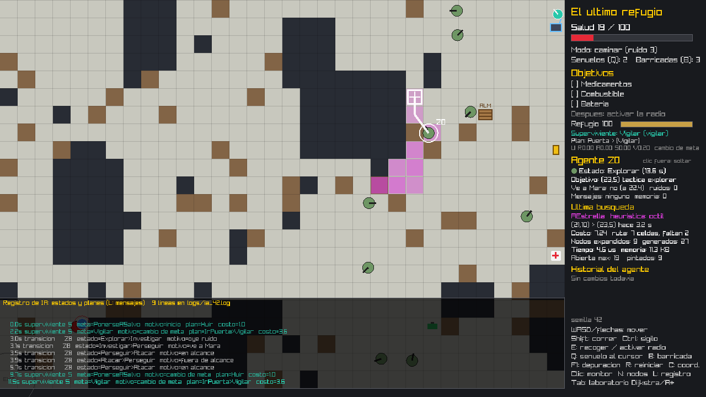

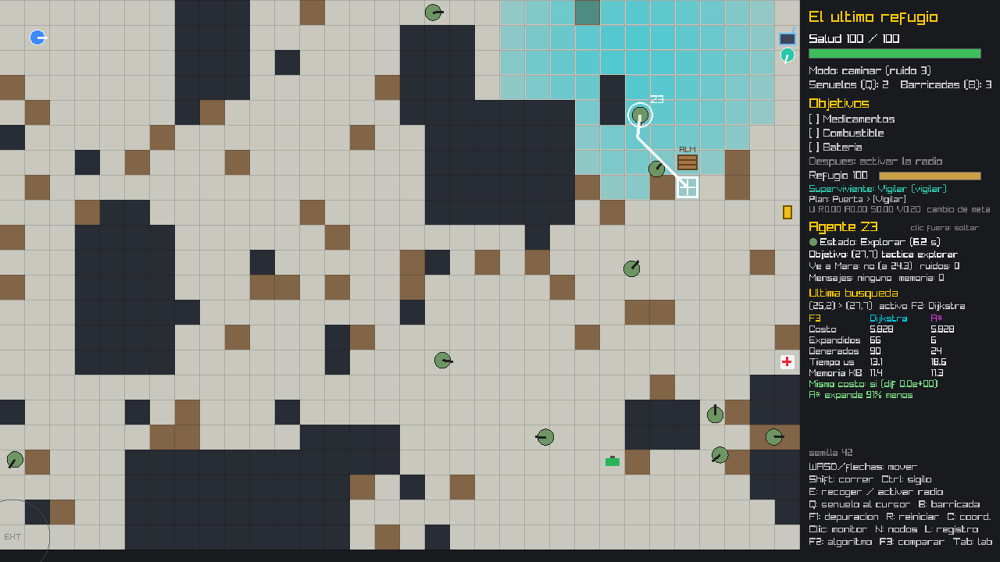

## 4. Algoritmos implementados

### 4.1 Grafo de navegación

Grafo **implícito** sobre la rejilla (ADR-0006): V = celdas transitables; aristas a los 8 vecinos sin cortar
esquinas; costo w(u, v) = d · m(v), con d ∈ {1, √2} y multiplicador de terreno m ∈ [1, 10] (escombros y
terreno lento). Todos los pesos son ≥ 1, así que Dijkstra es válido. No se guardan listas de adyacencia: los
vecinos se calculan con desplazamientos, y cada nodo ocupa 16 bytes de estado de búsqueda (g, padre,
generación, cerrado) que se reinicia en O(1) con un índice de generación.

### 4.2 Dijkstra y A\*

Los dos usan la **misma** implementación, interfaz (`IBuscadorRuta`) y grafo: Dijkstra es A\* con h ≡ 0.
Lista abierta en montículo binario. La búsqueda es **reanudable** (ADR-0007): guarda abierta, g, padre y
cerrado y continúa en el tick siguiente con exactamente el mismo orden de expansión, de modo que entre todos
los infectados no se expanden más de 4000 nodos por tick de IA. Las solicitudes se atienden por prioridad
(perseguir antes que explorar) con envejecimiento para que nadie espere para siempre.

### 4.3 Heurística octil: admisibilidad y consistencia

h(n) = (dx + dy) + (√2 − 2) · min(dx, dy), multiplicada por m_min = 1.

* **Admisible**: en una rejilla 8-conexa sin obstáculos y con m = 1, la distancia octil es exactamente el
  costo mínimo. Los obstáculos y m(v) ≥ 1 solo pueden aumentar el costo real, luego h(n) ≤ h\*(n).
* **Consistente**: para una arista (n, n') con costo w ≥ d(n, n'), la desigualdad triangular de la métrica
  octil da |h(n) − h(n')| ≤ d(n, n') ≤ w, es decir h(n) ≤ w(n, n') + h(n').
* **Consecuencia**: con h consistente, la primera vez que un nodo se cierra su g es óptimo, así que **no se
  reabren nodos**. El benchmark lo confirma: 0 discrepancias de costo y 0 consultas en que A\* expandiera
  más nodos que Dijkstra (§6.2).

### 4.4 Recursividad

| Procedimiento | Caso base | Progreso | Pila |
|---|---|---|---|
| **Propagación de alertas** (RF-047) | profundidad = 3, o vecino ya en el conjunto de visitados S | p + 1 en cada llamada; \|S\| crece hasta n | ≤ 4 marcos, O(D); S en O(n) bits |
| Quadtree (inserción y consulta) | hoja o profundidad 8 | el cuadrante se divide entre 4 | ≤ 9 marcos |
| Árbol de comportamiento | hoja (Éxito, Fallo, EnCurso) | se desciende un nivel | profundidad ≤ 10 |

La alerta es la recursión del storyboard: quien ve a Mara avisa a los infectados a 5 celdas o menos, estos a
los suyos, hasta 3 saltos, con la confianza multiplicada por 0,7 en cada salto (1 → 0,7 → 0,49 → 0,34).

### 4.5 Coordinación multiagente

* **Contract Net** (RF-049): el infectado que ve a Mara anuncia tareas (perseguir, interceptar el punto donde
  estará en 2 s, flanquear por un acceso del lado opuesto); cada alertado puja con su distancia y cada tarea
  se adjudica a la puja más baja, una por agente.
* **Reparto de la llegada** (RF-051): con dos o más perseguidores, las 8 celdas alrededor de Mara se
  reparten minimizando la suma de distancias, con 2 infectados por celda como máximo.
* **Campo de flujo** (RF-028): cuando 8 o más persiguen, un único Dijkstra inverso desde Mara sustituye sus
  búsquedas A\* individuales.
* **Steering** (RF-029): seguir, separación, alineación, cohesión, evitación de paredes y anticipación de
  choques, con vecinos del quadtree.

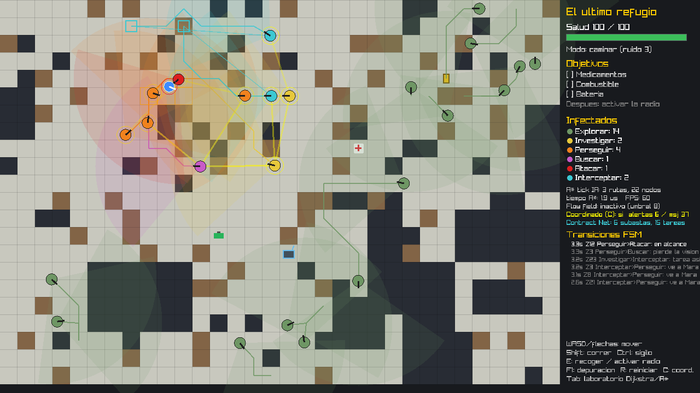

### 4.6 Heurísticas de decisión

* Utilidad de una evidencia: U = c · e^(−edad/τ) / (1 + d/10).
* Tácticas: Perseguir = c / (1 + d/10); Interceptar = 0,8 · c / (1 + d_corte/10), solo si conoce el rumbo
  de Mara y hay un punto de corte; Explorar = 0,15. Histéresis del 10 %.
* Superviviente: peligro p = 1 / (1 + e^(2(d − 3))) y cuatro metas (PonerseASalvo, RefugioSeguro,
  AyudarInstalacion, Vigilar) puntuadas en [0, 1].


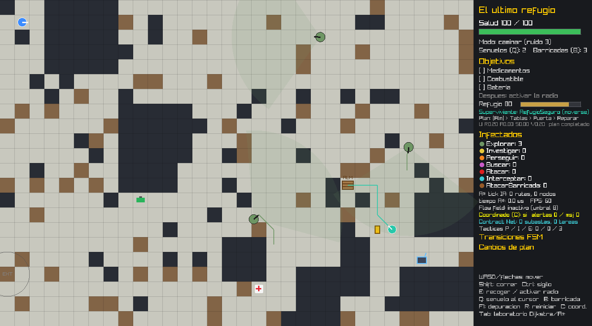

## 5. Autonomía y adaptación

### 5.1 Prueba de aceptación: señuelo y barricada

El storyboard pide «introducir un señuelo sonoro y una barricada; comprobar la actualización de objetivos
sin conocimiento omnisciente». Se cumple así, con pruebas automáticas que pasan:

1. **Señuelo** (Q): suena 10 veces con radio 8. Solo lo reciben los infectados que lo **oyen** (radio − 2 por
   pared). Cada uno compara la utilidad del señuelo con la de su objetivo actual y cambia si es mayor; quien
   ve a Mara no se distrae. CP-050: el cambio ocurre en ≤ 5 ticks de IA y queda en el registro con las dos
   utilidades.
2. **Barricada** (B): la celda deja de ser transitable y sube la versión del mapa. Solo el infectado que la
   **ve** en su ruta replanifica; si no hay rodeo o el rodeo cuesta más del doble, pasa a AtacarBarricada
   (10 puntos por segundo) y, al romperla, sigue con lo que hacía. CP-052 y CP-025 cubren los tres casos.

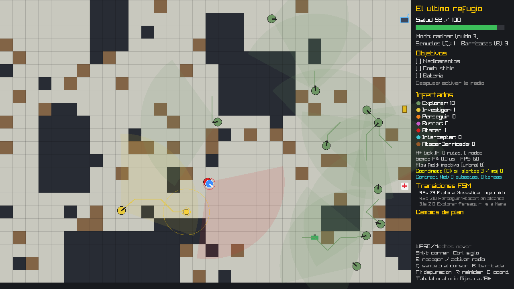

### 5.2 Replanificación ante un cambio del entorno

El escenario dinámico del benchmark (§6.3) hace lo mismo a escala: 400 recorridos en los que aparece una
barricada 4 celdas por delante del agente en el tick 30. Todos replanifican una vez desde donde están y todos
llegan.

## 6. Complejidad: análisis teórico y experimental

### 6.1 Análisis teórico

V = celdas transitables, E ≤ 8V, n = agentes, k = vecinos, D = profundidad, b = ramificación.

| Algoritmo | Tiempo | Espacio |
|---|---|---|
| Dijkstra (montículo binario) | O((V + E) log V) = O(V log V) porque E ≤ 8V | O(V) |
| A\* (octil, consistente, sin reapertura) | O(V log V) en el peor caso; expande ≤ Dijkstra | O(V) |
| Campo de flujo (Dijkstra inverso) | O(V log V) una vez por celda de Mara, amortizado entre los perseguidores | O(V) |
| Propagación de alertas | O(n · k) | O(D) pila + O(n) bits |
| Quadtree: construcción / consulta | O(n log n) / O(log n + k) promedio | O(n) |
| Contract Net | O(m · t) mensajes (m agentes, t tareas) | O(m · t) |
| GOAP (A\* regresivo) | O(b^D), D ≤ 6 | O(b^D) |
| Algoritmo genético | O(G · P · C), C = costo de evaluar un candidato | O(P) |
| Recocido simulado | O(I · C) | O(1) |

A\* no garantiza menos tiempo en todos los casos (guía §5): si la heurística informa poco (por ejemplo, un
destino detrás de un muro largo), expande casi lo mismo que Dijkstra y paga el cálculo de h.

### 6.2 Benchmark Dijkstra frente a A\*

**Condiciones** (guía §7): `refugio_bench --bench bench/config.json`, mismos mapas, orígenes, destinos y
costos para los dos algoritmos; ciudades generadas de 32², 64², 128² y 256² con 25 % de obstáculos y 10 %
de terreno caro; 20 pares origen-destino por tamaño y 5 repeticiones por condición (800 mediciones);
semilla maestra 42. Equipo: Intel Xeon 2,3 GHz, 4 núcleos lógicos, 16 GB, Ubuntu 24.04, GCC 13.3, Release.
Datos: [`informe/datos/bench_final.csv`](informe/datos/bench_final.csv).

| Mapa | Algoritmo | Costo (media) | Nodos expandidos (media) | Tiempo µs (mediana) | Tiempo µs (p95) | Memoria KB |
|---|---|---|---|---|---|---|
| 32² | Dijkstra | 23,98 | 477 | 30,6 | 54,9 | 16,9 |
| 32² | A\* | 23,98 | 100 | 5,1 | 31,8 | 17,1 |
| 64² | Dijkstra | 35,82 | 1 326 | 96,7 | 223,5 | 65,7 |
| 64² | A\* | 35,82 | 185 | 18,7 | 61,0 | 66,0 |
| 128² | Dijkstra | 81,32 | 5 992 | 635,5 | 1 423,8 | 259,5 |
| 128² | A\* | 81,32 | 887 | 127,0 | 747,2 | 261,5 |
| 256² | Dijkstra | 165,08 | 26 907 | 2 828,9 | 5 608,5 | 1 031,6 |
| 256² | A\* | 165,08 | 3 308 | 548,4 | 1 441,3 | 1 040,8 |

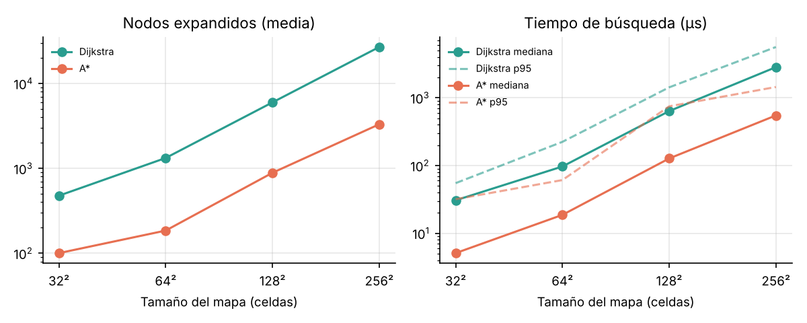

**Lectura**:

* **Optimalidad**: en las 400 consultas el costo de A\* coincide con el de Dijkstra (tolerancia 1e-6) y en
  ninguna A\* expande más nodos. Es lo que predice la consistencia de la heurística (§4.3).
* **Nodos**: A\* expande de media un 81 % menos en 32², 84 % en 64², 87 % en 128² y 88 % en 256². El ahorro
  crece con el mapa porque Dijkstra explora un disco alrededor del origen mientras A\* se concentra en la
  dirección del destino.
* **Tiempo**: A\* es entre 5 y 6 veces más rápido en la mediana. La pendiente log-log del tiempo mediano
  frente al número de celdas es 1,12 para Dijkstra y 1,15 para A\*: un crecimiento algo mayor que lineal,
  coherente con O(V log V). (Que A\* tenga una pendiente parecida indica que, en estas ciudades, la fracción
  del mapa que explora no baja al crecer el mapa.)
* **Memoria**: igual en los dos (≈ 16 bytes por celda más la abierta), O(V), y lineal en V: ×4 celdas da ×4
  memoria. A\* gasta un poco más por guardar f.
* **Variación**: la mediana es estable entre corridas, el p95 no tanto. En una segunda corrida idéntica el
  p95 de A\* en 128² fue 326 µs en vez de 747 µs, por ruido de la máquina virtual; las dos quedan bajo 1 ms.

### 6.3 Escenario dinámico

Mismos mapas de 64² y 128²; el agente recorre su ruta una celda por tick y en el tick 30 aparece una
barricada 4 celdas por delante. Datos: [`informe/datos/bench_final_dinamico.csv`](informe/datos/bench_final_dinamico.csv).

| Mapa | Algoritmo | Costo recorrido | Nodos (suma de búsquedas) | Tiempo µs (mediana) | Replanificaciones | Sin llegar |
|---|---|---|---|---|---|---|
| 64² | Dijkstra | 65,79 | 3 881 | 281,6 | 1,00 | 0 |
| 64² | A\* | 65,68 | 861 | 72,5 | 1,00 | 0 |
| 128² | Dijkstra | 84,46 | 10 780 | 736,1 | 1,00 | 0 |
| 128² | A\* | 84,45 | 1 323 | 140,4 | 1,00 | 0 |

Los dos replanifican en el 100 % de los recorridos y llegan. La pequeña diferencia de costo recorrido
(0,1 %) no contradice la optimalidad: cuando hay varias rutas de igual costo, cada algoritmo desempata
distinto, la barricada cae en otra celda y el rodeo resultante es otro. A\* ahorra un 78-88 % de los nodos
también al replanificar.

### 6.4 Presupuesto de búsqueda en el juego

Con el A\* reanudable (0.15.0), 100 solicitudes en el mismo tick en una ciudad de 128² se resuelven en 5 ticks
sin pasar de 4000 nodos ni de 0,7 ms por tick, y una partida de 100 infectados en 128² durante 60 s hizo 1477
búsquedas con una espera máxima de 4 ticks de IA (prueba CP-026).

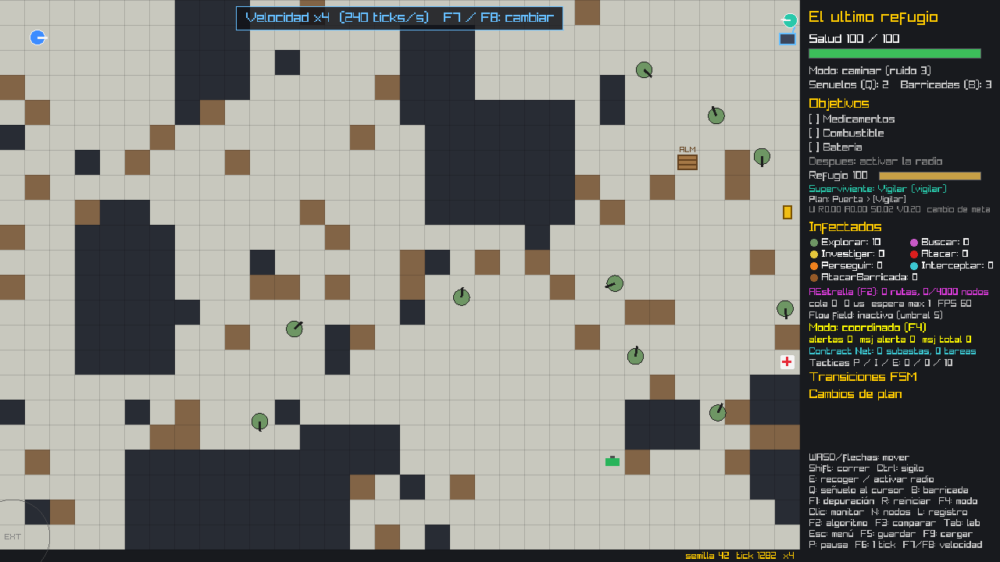

## 7. Experimento: agentes aislados frente a coordinados

**Diseño** (storyboard §03): `refugio_bench --coord-exp 7 --reps 10`. Diez pares de partidas; la repetición
r usa la semilla 7 + r en los dos modos, así que cada par comparte mapa, infectados y objetos. 10 infectados y
un tope de 120 s. Mara sigue un **guion fijo** que no mira a los infectados (A\* a cada objeto, radio y
extracción), para que la única diferencia sea la comunicación. En modo aislado no hay alertas ni Contract Net;
todo lo demás es igual. Datos: [`informe/datos/coord_final.csv`](informe/datos/coord_final.csv).

**Comprobación del diseño**: hasta la primera detección las dos partidas de cada par deben ser idénticas,
porque todavía no hay nada que comunicar. La huella de estado del tick anterior a la detección coincide en los
10 pares.

| Métrica (media de 10) | Aislado | Coordinado | Diferencia | Wilcoxon pareado |
|---|---|---|---|---|
| Máx. infectados a ≤ 2 celdas de Mara | 5,3 | 7,5 | **+2,2** | p = 0,020 |
| Mensajes entre agentes | 0 | 510,6 | — | — |
| Duración hasta la derrota (s) | 21,6 | 20,5 | −1,1 | p = 0,037 |
| Celdas sobrecargadas (suma por tick de IA) | 15,5 | 29,5 | +14,0 | p = 0,039 |
| Cobertura del mapa | 35,2 % | 33,2 % | −1,9 pp | p = 0,16 |
| Primer contacto (s) | 6,49 | 6,52 | +0,03 | p = 0,75 |
| Victorias del guion | 0 de 10 | 0 de 10 | — | — |

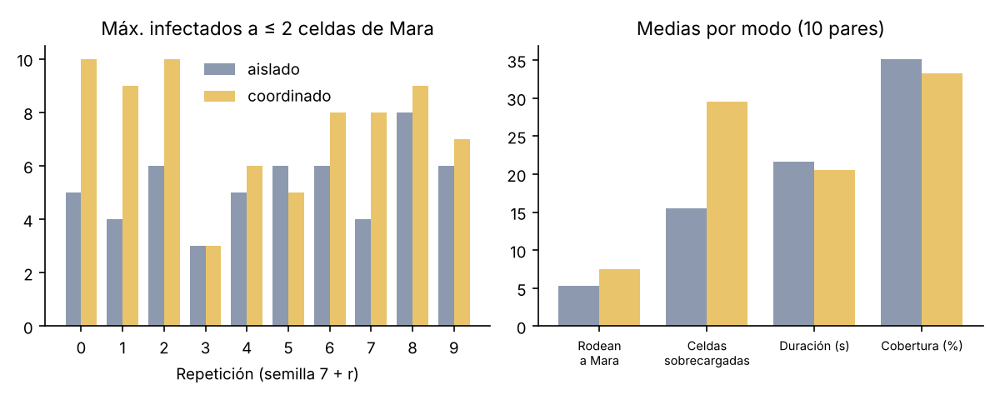

**Lectura**:

* La coordinación **cambia el comportamiento de forma medible**: con alertas y Contract Net, 2,2 infectados
  más de media llegan a rodear a Mara (más en 8 de los 10 pares, igual en 1 y menos en 1), y la derrota llega
  1 s antes. Es la escena 3 del storyboard («la horda distribuye aproximaciones»).
* El primer contacto no cambia (p = 0,75): lo produce quien ya estaba cerca; la comunicación actúa
  **después**, trayendo refuerzos. La cobertura baja un poco porque los alertados dejan de explorar.
* **Hallazgo negativo**: las celdas sobrecargadas (más de 2 infectados en una celda) casi se duplican. El
  reparto de llegada limita 2 por celda solo para quienes persiguen, pero con más infectados convergiendo a la
  vez se amontonan en los accesos antes de llegar. El storyboard pide «evitar concentrarse en una celda», así
  que esto queda como mejora (§11).
* Un guion que no esquiva pierde siempre en los dos modos, así que el experimento mide presión, no
  dificultad para una persona.
* En la versión 0.11.0 el mismo experimento dio 7,4 frente a 5,3. El cambio a 7,5 es esperable desde 0.15.0,
  que reparte las búsquedas entre ticks y cambia en qué tick recibe ruta cada agente; las conclusiones no cambian.

## 8. Optimización de parámetros: algoritmo genético y recocido simulado

**Qué se optimiza** (ADR-0015): once pesos de la horda (cinco de steering, tres de utilidad de tácticas y
la visión, velocidad y daño del perseguidor). **Aptitud**: cada candidato juega 8 partidas sin ventana
(semillas 11 a 18, horda coordinada, el mismo guion de §7), con

aptitud = presión + cobertura − 0,5 · celdas sobrecargadas por tick de IA − 4 · desvío de la tasa de
victorias del guion fuera de [20 %, 40 %], con presión = 1 − t_contacto / 90 s.

| | Algoritmo genético | Recocido simulado |
|---|---|---|
| Configuración | 30 individuos × 40 generaciones, torneo de 3, cruce uniforme 0,9, mutación gaussiana σ = 0,1 (p = 0,2), elitismo 2 | 2000 iteraciones, T₀ = 0,05, enfriamiento geométrico α = 0,995, vecino gaussiano σ = 0,1 |
| Evaluaciones / simulaciones | 1 122 / 8 992 | 2 001 / 16 024 |
| Tiempo (4 hilos) | 7,6 s | 16,2 s |
| Aptitud: pesos actuales → mejor | 0,418 → **1,406** | 0,418 → **1,356** |
| Victorias del guion | 0 → 2 de 8 | 0 → 3 de 8 |
| Cobertura | 34,4 % → 48,5 % | 34,4 % → 43,7 % |
| Celdas sobrecargadas por tick de IA | 0,128 → 0,025 | 0,128 → 0,023 |
| Visión / velocidad / daño del perseguidor | 6 / 3,4 / 10 → **2,5 / 1,6 / 4** | 6 / 3,4 / 10 → **2,5 / 1,64 / 4** |

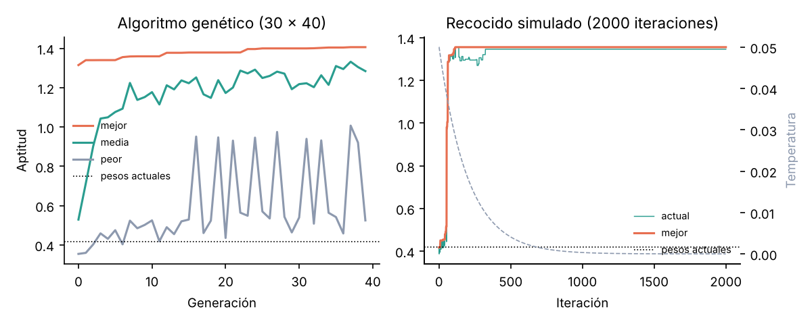

**Lectura**:

* Los dos métodos triplican la aptitud y llegan a valores parecidos por caminos distintos. El mejor del GA
  nunca baja (elitismo; el programa lo comprueba). El SA da el salto en las primeras 150 iteraciones, cuando
  la temperatura todavía acepta empeoramientos (31 de 73 aceptaciones fueron empeoramientos), y luego se
  estanca: con α = 0,995 la temperatura cae demasiado pronto.
* Los dos reducen mucho las celdas sobrecargadas, el problema que el experimento de §7 encontró.
* **Por qué no se adoptan**: para que el guion gane un 20-40 % de las partidas, los dos optimizadores bajan la
  visión a 2,5 celdas y la velocidad del perseguidor a 1,6 celdas/s, **por debajo de la de Mara caminando
  (3)**. El guion no esquiva a nadie, así que esos pesos sobreajustan al guion y harían la horda demasiado
  fácil para una persona. Por eso `config/ia.json` conserva los pesos originales. Es un resultado útil: la
  función de aptitud necesita una restricción de velocidad mínima o un oponente que esquive.
* Datos: [`opt_ga_final.json`](informe/datos/opt_ga_final.json) y [`opt_sa_final.json`](informe/datos/opt_sa_final.json),
  con la aptitud por generación e iteración y la sección `"pesos"` lista para copiar.

## 9. Requisitos no funcionales medidos

| RNF | Objetivo | Resultado | Estado |
|---|---|---|---|
| RNF-003 Tiempo de búsqueda A\* en 128² | p95 ≤ 1 ms | mediana 127 µs; p95 326-747 µs en dos corridas | Cumple |
| RNF-005 Memoria en el benchmark (256²) | ≤ 64 MB | RSS pico 13,1 MB | Cumple |
| RNF-006 Cero asignaciones por paso | 0 | 0 (prueba CP-106) | Cumple |
| RNF-007 Tamaño de una partida guardada | ≤ 64 KB por 10 min | ≈ 16 KB | Cumple |
| RNF-019 Optimalidad de A\* | 0 discrepancias | 0 de 400 | Cumple |
| RNF-020 Determinismo | misma huella | 10 de 10 pares idénticos hasta la detección; 600 ticks a cualquier velocidad dan la misma huella (CP-075) | Cumple |
| RNF-027 Recursión acotada | profundidad ≤ límite declarado | 100 % de las llamadas, con estrés de hasta 2000 agentes en ASan (CP-127) | Cumple |

De los 32 RNF, 6 están verificados, 25 implementados con la medición incompleta y 1 pendiente (RNF-029,
escalado de pantalla). FPS, tiempo de tick, CPU, memoria del juego y arranque se miden con ventana en el
equipo de la sustentación (§9.1); el método está en `docs/04_requisitos_no_funcionales.md`.

<!-- generado:rendimiento inicio -->
### 9.1 Rendimiento con ventana en el equipo de la sustentación

Pendiente de medir. En el equipo de la sustentación, con el juego compilado en Release:

```bash
python tools/rendimiento.py medir
```

El juego se abre, arranca 5 veces y juega solo dos partidas (10 y 100 infectados) durante unos 12 minutos;
al terminar, la herramienta rellena esta sección, `docs/trazabilidad.csv` y las filas de estado de RNF-001,
RNF-002, RNF-004, RNF-005 y RNF-008.
<!-- generado:rendimiento fin -->

## 10. Calidad y pruebas

* **198 pruebas automáticas** (Catch2 v3 + CTest) en 0.18.0, todas en verde (172 en 0.16.0); además se ejecutan con
  AddressSanitizer y UBSan (preset `asan`) y en integración continua.
* **Trazabilidad** (0.18.0): 23 historias de usuario terminadas, 68 RF (63 verificados y 5 implementados, ninguno
  pendiente), 32 RNF y 104 casos de prueba (69 pasan, 19 parciales, 16 pendientes), enlazados en
  `docs/06_matriz_trazabilidad.md` y `docs/trazabilidad.csv` (generada con `tools/trazabilidad.py`).
* **Decisiones**: 20 ADR en `docs/adr/`.

## 11. Pendientes y limitaciones

| Pendiente | Situación |
|---|---|
| RF-001, RF-006, RF-015 y RF-048 | Hechos en 0.18.0 (§2.1). Queda: el perseguidor usa los 6 celdas y 3,4 celdas/s de `pesos`, no los 5 y 4 del prototipo, para que la horda sea jugable. |
| RNF-001, 002, 004, 005, 008 | FPS, tick, CPU, memoria y arranque con ventana: ver §9.1 (`tools/rendimiento.py`). |
| RNF-029 | Ventana fija de 1280 × 720, sin escalado. |
| Concentración de la horda | La coordinación duplica las celdas sobrecargadas (§7). |
| Aptitud del GA/SA | Sobreajusta al guion fijo; falta una restricción de velocidad o un oponente que esquive (§8). |

## 12. Reproducibilidad

Todo lo de este informe se repite con la versión 0.16.0:

```bash
cmake --preset headless && cmake --build --preset headless && ctest --preset headless
B=build/headless/refugio_bench
$B --bench bench/config.json --salida results/bench_final.csv     # §6.2 y §6.3
$B --coord-exp 7 --reps 10 --salida results/coord_final.csv       # §7
$B --optimize ga --config opt/ga.json --salida results/opt_ga_final.json   # §8
$B --optimize sa --config opt/sa.json --salida results/opt_sa_final.json
python tools/resumen_bench.py results/bench_final.csv
python tools/graficas_informe.py results docs/informe/figuras     # figuras y pruebas de Wilcoxon
```

Los CSV y JSON llevan en la cabecera versión, commit, CPU, núcleos, RAM, sistema, compilador, opciones,
fecha y semilla. Con la misma semilla los costos, nodos, métricas del experimento y resultados del GA/SA son
idénticos; solo cambian los tiempos. En Windows, `refugio.exe` acepta las mismas opciones.

## 13. Conclusiones

* Los infectados cumplen el ciclo percepción → memoria → decisión → planificación → ejecución → evaluación
  sin información global, y reconsideran sus planes ante señuelos, barricadas y alertas; cada decisión queda
  registrada con su motivo y se ve en el panel.
* Dijkstra y A\* se comparan sobre el mismo grafo con datos reales: A\* es siempre óptimo (heurística octil
  consistente, sin reapertura), expande entre un 81 % y un 88 % menos nodos y es unas 5 veces más rápido, con
  la misma memoria O(V).
* La coordinación por alertas recursivas y Contract Net produce una horda que rodea a Mara con un 42 % más de
  infectados (p = 0,02), a costa de más aglomeración.
* El GA y el SA mejoran la aptitud definida, pero el análisis de los pesos resultantes muestra que la función
  de aptitud premia una horda más lenta que Mara, y por eso no se usan en el juego.

## Anexo A · Correspondencia con la guía y el storyboard

| Exigencia | Dónde se cumple |
|---|---|
| Arquitectura de agentes (guía §4) | §3.1; `docs/07_arquitectura_arc42.md` §8.2 |
| Dijkstra y A\* sobre el mismo grafo con pesos no negativos (§5) | §4.1, §4.2 |
| Admisibilidad y consistencia de la heurística (§5) | §4.3; RF-022 |
| Recursividad con caso base, progreso y pila (§5) | §4.4; RF-047 |
| Memoria, autonomía y comunicación multiagente (§5) | §3, §4.5, §5 |
| Complejidad en función de V, E, D y b (§5) | §6.1 |
| Panel de monitoreo y registro de planes y mensajes (§6) | §3.4 |
| Comparación con iguales mapas, varios tamaños, ≥ 5 repeticiones, metadatos (§7) | §6.2, §6.3 |
| Cambios del entorno (§7) | §5, §6.3 |
| Aislados frente a coordinados con la misma semilla (storyboard §03) | §7 |
| Señuelo y barricada sin omnisciencia (storyboard, prueba de aceptación) | §5.1 |
| Registros y resultados de pruebas (§8) | `docs/informe/datos/`, §10 |
| Instrucciones de ejecución (§8) | §2, §12, `README.md` |
